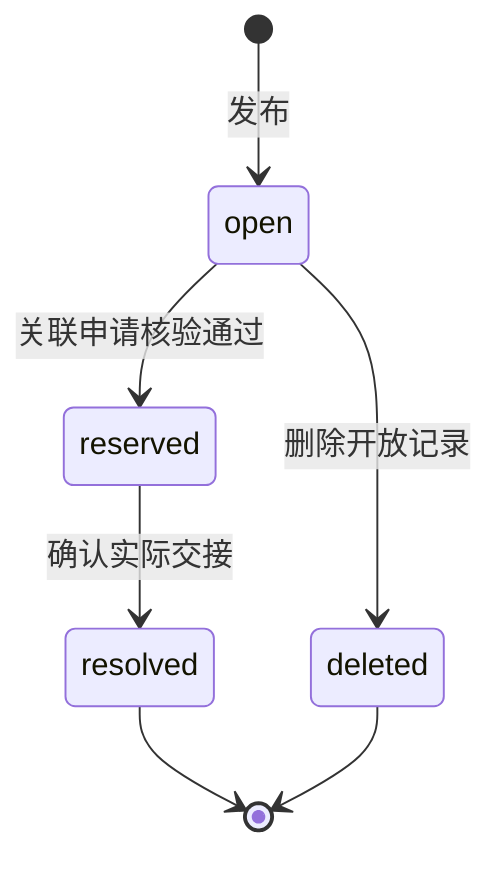
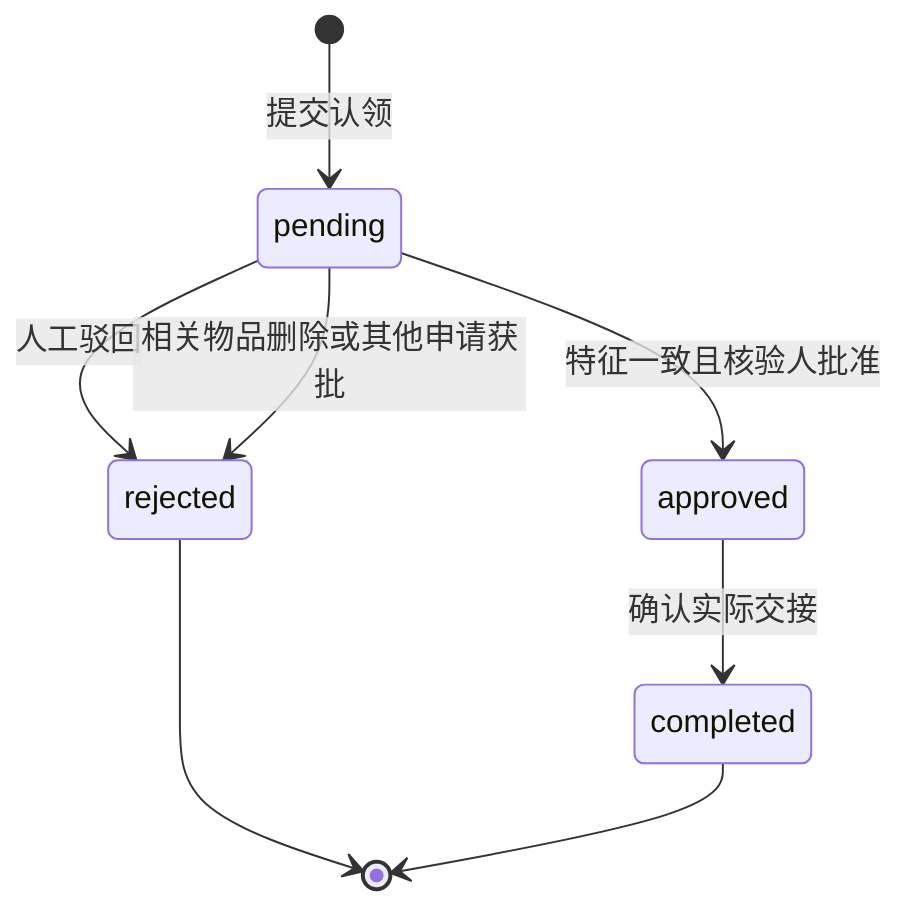
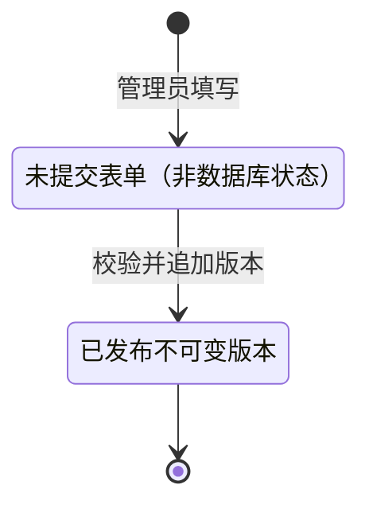

# 01 需求规格

状态：一期当前实现基线  
日期：2026-10-27  
题目：校园失物招领与智能匹配系统（T03）  
项目名称：校园拾光

本规格依据题目 PDF 第 2–7 页，并对照当前项目代码整理。第 1 节至第 10 节描述本期实际范围和验收口径，第 11 节汇总已核实的实施基线。后续变更业务范围时，应同步维护 `02-plan.md`、`03-architecture.md`、接口文档及相关测试。

实现依据：[业务服务](../src/service.py)、[匹配引擎](../src/matching.py)、[数据模型](../src/database.py)、[HTTP 服务](../src/server.py)和[前端代码](../src/static/app.js)。本文件不把样板中的技术选型或尚未实现的能力作为本项目已有功能。

## 1. 问题与目标

失物和招领信息散落在群聊里，发布字段和描述口径不统一，学生难以判断两条信息是否指向同一物品。若直接公开联系方式和物品独有特征，又会增加隐私泄露和冒领风险。

本系统提供一个本地可运行、可验证、可解释的校园失物招领闭环：

1. 失主和拾获者使用统一字段发布失物、招领信息，可选上传物品图片。
2. 访客和登录用户按关键词、类别、地点、日期范围、状态和信息类型查找记录。
3. 登录用户对本人开放记录请求匹配，系统基于当时的规则和引擎版本给出候选分数、置信等级及自然语言依据。
4. 用户对他人的开放招领发起认领，回答至少一个未公开特征，由拾获者或管理员核验。
5. 核验通过后向成功认领双方开放联系方式，确认实际交接后将招领及关联失物结案。
6. 发布、认领、核验、驳回、删除、结案和规则发布留下审计记录；管理员发布新规则后，历史推荐仍可使用旧输入和旧版本重算。

匹配结果只作为候选，不自动判定物品归属，不自动核验通过或结案。系统采用题目允许的可复现离线 AI 模拟方案，验收无需购买服务、联网调用模型或提供密钥。

## 2. 用户角色

账号的系统角色只有 `user` 和 `admin` 两种，大小写与数据库一致。失主、拾获者是业务身份，同一普通账号可以发布两种类型的信息。另允许未登录访客浏览公开内容。

| 系统角色 | 典型身份 | 能做的事 |
| --- | --- | --- |
| 未登录访客 | 查找线索的学生 | 浏览广场、搜索筛选、查看公开详情；不能发布、生成匹配、申请认领或处理业务 |
| `user` | 失主、拾获者 | 使用预置账号登录/退出；发布失物或招领；查看本人发布；请求本人记录的候选匹配；申请认领他人招领；审核自己招领收到的申请；确认交接；删除自己的开放记录 |
| `admin` | 校园管理员 | 拥有普通用户能力；管理任意记录的核验、交接和开放记录删除；为任意开放记录生成匹配；查看推荐历史；发布规则版本；查看全部审计 |

第一版不开放注册、密码找回或个人资料维护。初始化提供 3 个演示账号：管理员 `admin`、以失主样例为主的 `alice`、以拾获者样例为主的 `bob`。两个普通账号都能发布两类信息，无需另设第四个账号。

### 权限

| 内容或动作 | 发布者 | 其他登录用户 | 管理员 |
| --- | --- | --- | --- |
| 广场公开字段、公开详情、核验问题 | 可见 | 可见，访客也可见 | 可见 |
| 记录中的发布者联系方式 | 本人可见 | 仅相关认领通过或完成后的对应当事人可见 | 可见，用于管理；当前未限制为仅核验页 |
| 申请中的认领人联系方式 | 核验通过或交接完成后可见 | 仅对应申请的参与者在通过/完成后可见 | 申请列表同样在通过/完成后返回；有权查看关联物品的联系方式 |
| 预设私密答案、答案哈希、申请答案明文 | 提交后不提供读取 | 不可见 | 不提供读取；审核使用核验结果 |
| 私密特征是否匹配 `feature_matches` | 作为该招领核验人可见 | 申请者及无关用户不可见 | 可见 |
| 匹配依据 | 本人生成的推荐可见，只引用公开字段 | 不能读取其他人的推荐批次 | 可查看全部推荐历史及复算 |
| 审核、交接、删除 | 仅自己的记录，且满足状态限制 | 无权处理他人的记录 | 可处理任意记录，仍需满足业务状态和特征核验约束 |
| 发布规则、查看全部审计 | 否，除非本身为管理员 | 否 | 是 |

未登录可访问公开读取接口；本人数据、认领、推荐历史等接口要求会话，写接口还要求 CSRF 校验。所有权限由后端检查，前端隐藏按钮不作为鉴权依据。没有独立的用户联系方式资料页，联系方式随发布或认领填写。

## 3. 用户故事

1. 作为拾获者，我希望发布招领时区分公开描述与私密核验问题/答案，并可附图片，以便寻找失主时保留一个未公开的辨识特征。
2. 作为失主，我希望按地点、类别、日期和状态搜索招领，看到系统为什么推荐某条记录，以便决定是否申请认领。
3. 作为失主，我希望回答只有真正失主知道的私密特征，并可关联自己发布的失物，以便核验与后续结案形成闭环。
4. 作为拾获者，我希望看到申请答案与预设特征是否一致，必要时填写原因驳回，再人工确认核验通过，以降低只凭公开描述冒领的风险。
5. 作为认领双方，我希望通过前不向对方公开联系方式，通过后能联系交接，完成交接后两条相关记录共同结案。
6. 作为管理员，我希望调整匹配字段及权重并发布不可修改的新版本，事后能查到推荐使用的规则及引擎，并复算原分数。
7. 作为信息不足的发布者，我希望系统明确标注证据不足、降低分数并拒绝判断归属，避免将较少线索包装成高置信结论。

## 4. 用例

### UC1 发布

1. 登录用户选择失物 `lost` 或招领 `found`。
2. 填写标题、类别、起止日期、地点、颜色、公开描述和联系方式。颜色不确定时可填“不详”或“未知”。
3. 发布招领必须设置 1 个未公开特征问题及其答案；失物不要求、不保存这两个核验字段。
4. 可选上传 PNG/JPEG/WebP 图片，解码后不超过 500000 字节。图片只展示，不参与匹配。
5. 系统校验日期有效且开始不晚于结束、类别合法、必填内容和长度符合限制。招领答案经规范化后不得直接包含在任一公开文字字段中。
6. 保存记录，状态为 `open`，记录审计 `item.created`；公开信息可立即在广场查看。搜索不读取联系人或秘密答案。

主要长度限制：标题 80 字、地点 100 字、颜色 30 字、描述 2000 字、联系方式 150 字、核验问题 200 字、私密答案 100 字。地点和颜色使用自由文本，不要求从校园枚举中选择。照片是否泄露私密特征由发布者人工检查。

发布后未提供编辑接口。公开字段、核验问题/答案、图片和联系方式均不能修改；开放记录填错时可填写删除原因后重新发布。已有记录按软删除保留，不以新记录覆盖历史记录。

### UC2 搜索筛选

访客或登录用户可组合使用关键词、类别、地点、日期范围、状态、失物/招领类型筛选；“我的发布”只返回本人记录，要求登录。

关键词仅匹配标题、公开描述和地点；类别通过独立条件精确筛选，地点条件做文本包含匹配。日期按两个区间是否重叠筛选，包含边界日期。状态取接口中的小写代码，界面显示中文。

结果按记录 ID 倒序（最近创建优先），单次最多 500 条；删除记录不出现在列表中，空结果有明确提示。关键词不搜索联系方式、私密答案、申请内容或照片，颜色没有单独筛选控件。

### UC3 查看候选匹配

1. 登录用户在本人 `open` 记录上请求匹配；管理员可为任意开放记录请求匹配。
2. 系统读取最新规则版本，只比较相反类型、`open` 状态、非该记录发布者本人发布的记录。按候选 ID 升序最多选取 500 条参与计算。
3. 对每条候选生成 0–100 分得分、置信等级、启用字段明细和自然语言解释。批次保存源及候选公开字段快照、归一化权重、规则 ID、引擎版本和完整结果。
4. 启用且双方有值的有效字段少于 3 项时，仍返回该候选，但标记 `insufficient`、分数最高 35，并说明拒绝判断归属；不会自动删掉整个候选列表。
5. 结果按分数降序、候选 ID 升序排列。当前不按最低得分截断，也没有只展示前 10 条的规则。
6. 生成者或管理员可按历史批次 ID 复算。复算只使用保存的快照和版本，不读取当前物品字段或最新规则，并返回结果是否与原批次完全一致。

历史候选原记录已删除时，查看其当前详情会返回不存在，但不影响历史批次复算。匹配是双向的，认领操作只对招领开放；拾获者查看失物候选不会变成“认领他人的失物”。

### UC4 认领与核验

1. 登录用户对他人发布且处于 `open` 的招领填写私密特征答案、受保护的联系方式和可选备注，可关联本人开放的失物记录。
2. 若 API 未单独传联系人，必须关联本人失物并使用其联系方式；当前前端要求显式填写联系人。不能关联他人失物或已经保留/结案的记录。
3. 系统将答案做 NFKC、忽略大小写和空白的规范化后，与预设答案的 PBKDF2 哈希比对，只保存是否一致，不保存申请答案明文。申请状态为 `pending`。
4. 申请提交响应不暴露答案对错。拾获者或管理员可在核验页看 `feature_matches`；申请者及无关用户无法读取该标志。
5. 核验人可人工批准或驳回。批准要求特征一致、申请仍待审、招领及可选关联失物仍开放；正确答案不会自动批准。
6. 批准后申请为 `approved`，招领及关联失物为 `reserved`，仅向对应双方及有权限的管理员开放联系方式。同一招领或同一关联失物的其他待审申请立即自动驳回。
7. 驳回必须填写原因，申请为 `rejected`，记录 `claim.rejected` 审计；驳回本身不改变开放物品状态，也不开放联系方式。

同一用户对同一招领只能申请一次，包括已被驳回的情况。核验通过意见可填写，API 不强制；前端批准操作提供默认说明。错误特征不能通过管理员身份绕过批准条件。

### UC5 交接结案

1. 申请必须为 `approved`，对应招领必须为 `reserved`，且实际物品已交接。
2. 招领发布者或管理员确认交接；申请人不能自行确认结案。
3. 同一事务内将申请更新为 `completed`，招领及已关联失物更新为 `resolved`，写入 `claim.completed`、`item.resolved` 审计。
4. 相关其他待审申请已经在核验通过时驳回，不等到结案才处理。
5. 交接双方仍可查看该次认领的联系方式。系统没有再次打开结案记录或撤销已完成交接的接口。

### UC6 删除

发布者或管理员可删除 `open` 记录，必须填写不超过 300 字的删除原因。删除是软删除，状态改为 `deleted`，记录退出广场、当前详情和新匹配候选范围，数据库记录及审计保留。

删除和关联待审申请的处理处于同一事务：该记录作为招领或关联失物涉及的 `pending` 申请更新为 `rejected`，原因记为“关联记录已删除”。删除写入 `item.deleted`，包括操作者、时间、原/新状态及原因。

`reserved` 或 `resolved` 记录不能删除。当前没有取消认领能力，不存在“先取消再删除”的操作路径；保留中的物品应在实际交接后结案。

### UC7 取消认领

本期未实现取消认领、撤销核验或恢复开放状态，不提供取消按钮、取消接口及 `cancelled` 状态。

`pending` 由拾获者或管理员核验通过/驳回；`approved` 由其确认实际交接后完成。申请人无法主动取消。该边界在本期验收中需明确展示，后续若增加取消功能，应另行定义状态回退、联系人重新隐藏、关联物品解锁及审计规则。

### UC8 发布规则

1. 管理员进入“规则与审计”，填写版本说明，调整类别、地点、颜色、时间、描述五个字段的权重。权重为 0 表示禁用该字段。
2. 发布时校验每个值为 0–100 的有限数，至少一个字段大于 0；未知字段被拒绝，缺省字段按 0 处理。
3. 系统自动将各值除以总和，保存归一化权重；不要求管理员输入的权重之和恰为 100。
4. 追加生成新的整数规则版本 ID，保存名称、引擎版本、发布者和时间，记录 `rule.published`。API 只允许追加，不编辑或覆盖历史版本。
5. 最大 ID 的版本对新推荐生效；历史推荐继续使用自己保存的规则、输入和引擎版本。

本期没有持久化规则草稿、阈值配置、最低可比权重配置、最短描述长度配置或可编辑同义词组。规则表单未提交前只是浏览器中的输入，不是数据库中的 `DRAFT` 版本。

## 5. 功能范围

### 5.1 本期实现

- 预置账号登录、退出及演示身份切换，服务端会话与对象权限检查。
- 失物/招领发布，支持标题、类别、日期范围、地点、颜色、描述、受保护联系方式和可选图片；招领设置一个私密核验问题及答案。
- 关键词、类别、地点、日期、状态、信息类型组合筛选，以及本人发布列表。
- 确定性离线候选匹配、置信等级、自然语言依据、规则/引擎版本追溯和历史批次复算。
- 对他人招领发起认领、可选关联本人失物、私密特征校验、人工审核、交接结案及软删除。
- 核验通过前保护双方联系方式，原始秘密答案不经读取接口返回。
- 关键状态变化审计和 HTTP 请求日志。
- 管理员字段启用/权重调整、新版本发布、版本历史及最近审计列表。
- 12 组离线匹配评测样例，正确匹配、相似但错误、信息不足各 4 组。
- README、配置示例、幂等初始化、自动化测试和源码打包/独立解压验证脚本。

页面组织：信息广场、我的发布、认领与交接、智能匹配、规则与审计。登录/身份切换、发布、公开详情、申请认领及操作确认使用弹窗，没有独立的注册、个人联系方式或规则草稿页面。

前端为 `src/static/index.html`、`styles.css`、`app.js`：HTML 提供骨架，CSS 提供布局，浏览器执行原生 JavaScript 请求 JSON 并生成内容。Python 同时提供静态文件和后端接口；应用启动不依赖 Node.js 或前端构建工具。

### 5.2 固定枚举

信息类型：`lost`（失物/寻物启事）、`found`（招领/拾物招领）。系统角色：`user`、`admin`。

类别固定为：电子产品、证件、钥匙、雨伞、书籍、包袋、衣物、其他。只有这 8 类可通过发布校验。

地点不是固定枚举，使用不超过 100 字的必填文本，例如“图书馆二楼”“体育馆东门”“教学楼A座”。没有单独的“地点补充”字段；地点全文参与检索和计分。

颜色不是固定枚举，使用不超过 30 字的必填文本，例如“黑色”“蓝色”“银色”“不详”。匹配时进行固定同义词规范化；未知值集合见第 7.2 节。

日期按 `YYYY-MM-DD` 保存为起止日期，不精确到时分秒。记录创建时间和审计时间由服务端以带 UTC 时区的 ISO 字符串保存，界面按浏览器时区显示。

### 5.3 状态

| 对象 | 枚举/表示 | 界面文案或含义 |
| --- | --- | --- |
| 物品记录 | `open` / `reserved` / `resolved` / `deleted` | 待认领 / 待交接 / 已结案 / 已删除（退出公开列表） |
| 认领申请 | `pending` / `approved` / `rejected` / `completed` | 待核验 / 已通过 / 已驳回 / 已交接 |
| 置信等级 | `high` / `medium` / `low` / `insufficient` | 高相似 / 中等相似 / 低相似 / 信息不足 |
| 规则 | 无草稿/发布状态列；以整数 ID 表示已发布版本 | 最新 ID 对新匹配生效，历史版本保留且不可修改 |

置信等级是计算标签，没有独立的状态迁移。`resolved`、`deleted`、`rejected`、`completed` 是当前业务终态。规则的“生效”由最大 ID 决定，不表示旧版本被删除。



物品的 `reserved` 状态同时用于招领和已关联失物。没有 `reserved → open` 回退。删除仅允许 `open`，并在同一事务内驳回关联的待审申请，不影响已保存的推荐输入快照。



同一招领最多存在一条 `approved` 或 `completed` 申请，数据库部分唯一索引兜底，核验事务内再次检查状态。`approved`、`completed` 时认领双方可以看到对应联系人；`pending`、`rejected` 时对方联系方式保持隐藏。发布者查看本人记录和管理员管理读取不受该对方隐藏条件限制。



该图只说明一次规则发布过程。页面输入不会自动持久化为草稿。后续修改需重新填写并发布另一版本，新旧版本分别保存，历史批次仍指向原版本。

## 6. 非功能要求

| 类别 | 要求 |
| --- | --- |
| 运行 | 本地安装 Python 3.11+，执行 `python app.py`，浏览器访问 `http://127.0.0.1:8000`；Windows 可双击 `start.cmd`；无第三方运行包、数据库服务器、GPU 或付费服务要求 |
| 前端依赖 | HTML/CSS/JavaScript 由 Python 提供，JavaScript 在浏览器执行；Node.js 仅用于可选语法检查和 Playwright 开发测试，不是应用启动依赖 |
| 持久化 | 用户、会话、物品、申请、规则、推荐快照和审计保存在 SQLite；默认 `data/campus.sqlite3`；正常重启保留数据 |
| 可复现 | 提供 README、`config.example`、幂等初始化、样例数据、测试、AI 评测和打包验证命令；配置示例不自动读取，CLI/环境变量负责实际配置 |
| 一致性 | 核验、保留相关物品、自动驳回、交接结案、软删除及其对应审计在各自数据库事务内完成；写操作使用 `BEGIN IMMEDIATE`，启用外键及唯一约束 |
| 可追踪 | 关键写操作记录业务审计，HTTP 日志包含请求 ID、方法、路径、状态；失败接口返回可读错误和请求 ID；当前审计列表最多 500 条，无按帖筛选接口 |
| 容量与性能边界 | 物品列表最多 500 条；一次匹配按 ID 升序最多选 500 条候选再排序；推荐历史最多 100 条；没有已验证的“1000 条/3 秒”性能承诺或大规模压测结果 |
| 界面 | 主流程可点击完成，提供空结果、加载/提交、成功和错误反馈；匹配页显示等级、依据、规则和引擎版本；适配桌面与手机布局 |
| 安全 | 密码和预设秘密答案采用带盐 PBKDF2；会话令牌哈希入库；cookie HttpOnly/SameSite=Strict；写接口校验会话、CSRF、Origin/Host；参数化 SQL、长度校验及受限静态路径 |
| 隐私 | 公开读取不返回联系人和秘密答案；匹配快照不含联系人、答案哈希或图片；应用不主动记录提交答案原文，用户也不应将无关隐私写入描述/备注 |
| 图片 | 仅接受小型 PNG/JPEG/WebP data URL，校验文件签名和大小，存入 SQLite；不加载外链图片，不做完整解码扫描、图像语义匹配或图片秘密检测 |
| AI 可用性 | 始终执行离线模拟器，无密钥、无网络时仍有分数和字段说明；没有云端模型配置、超时或模型润色流程 |
| 测试 | 核心权限、隐私、状态、并发、历史复算及初始化有自动化覆盖；AI 12 组用例可离线运行；具体执行结果和未测范围见 `06-test-report.md` |
| 交付真实性 | 过程文档、代码和测试保持一致；真实录屏不可由截图/聊天替代，当前未附开发全程及最终演示视频，缺口见 `recording-index.md` |

本期仅本地 HTTP 演示，默认只允许 `127.0.0.1` 或 `localhost`。没有生产 HTTPS、公开注册、真实校园认证、登录限流或密码找回，不据此宣称可直接上线。

## 7. 业务规则

### 7.1 字段划分

公开字段：记录 ID、发布者 ID/显示名、类型、状态、标题、类别、颜色、地点、起止日期、公开描述、创建时间、可选图片和核验问题。核验问题提示回答方向，答案本身必须保留为未公开特征。

受保护字段：记录中的 `contact` 和申请中的 `applicant_contact`。对方只在对应认领通过或完成后可见，发布者可管理读取本人记录，管理员可管理读取记录联系人。申请备注和审核说明仅在有权限的申请列表中返回，不作为广场公开字段。

不提供读取的秘密内容：预设答案仅以 `secret_hash` 保存，任何 API 都不返回该哈希；提交认领答案只用于比较，不保存明文。核验人读取布尔值 `feature_matches`，不读取原始答案。

匹配及解释只使用源/候选的 ID、标题、类型、类别、地点、颜色、公开描述和起止日期；照片不参与匹配。搜索只读取第 UC2 所列公开文字。发布校验能拒绝直接包含在公开文字中的规范化答案，不能识别图片、语义暗示或现实身份真实性。

### 7.2 计分

全新数据库默认建立“校园基础匹配规则”，规则 ID 为整数 `1`；界面展示 `v1`，这是规则序号，与字符串形式的算法版本不是同一概念。新规则绑定当前引擎 `offline-text-v2`，已有数据库可能保留绑定 `offline-text-v1` 的旧规则。

默认字段权重和计算方式：

| 字段 | 键 | 默认权重 | 字段分计算 |
| --- | --- | --- | --- |
| 类别 | `category` | 25% | 规范化后相同为 1，不同为 0；“其他”等未知值不作为有效证据 |
| 地点 | `location` | 20% | 规范化后相同为 1；一方包含另一方为 0.85；其余使用字符二元组 Dice |
| 颜色 | `color` | 15% | 规范化后相同为 1，不同为 0；“未知”“不详”等不作为有效证据 |
| 发生日期 | `time` | 15% | 两区间重叠（含同日）为 1；否则按最近间隔天数 `gap` 计算 `max(0, 1-gap/14)` |
| 公开描述 | `text` | 25% | 与地点同样使用精确/包含/字符二元组 Dice；标题不单独计分 |

文本先做 NFKC、大小写和固定同义词替换，再去除标点、空白和下划线，保留 Unicode 文字及数字。二元组取相邻两个字符组成的集合，短于两个字符时以单字符自身作为集合：

```text
Dice(A, B) = 2 × |A ∩ B| / (|A| + |B|)
base_score = 100 × Σ(归一化权重 × 字段分)
score = round(应用冲突及信息不足上限后的 base_score, 2)
```

任一端缺失或规范化值为空、未知、不详、不确定、其他、无时，该字段贡献 0，且不计入有效可比字段数。**不会因为字段缺失而重新按可比权重归一化**。启用字段的分项相似度保存到 6 位小数，总分保留 2 位小数。

防误判约束：

- 启用类别字段且双方类别已知但不同：总分最高 30。
- 启用颜色字段且双方颜色已知但不同：总分最高 49。
- 启用时间字段且双方有日期、时间相似度降为 0：总分最高 49。
- 启用且双方有值的有效可比字段少于 3 项：总分最高 35，等级固定为 `insufficient`，明确拒绝判断归属。
- 其余情况：分档判断采用尚未进行最终两位小数展示舍入的总分，`score >= 75` 为 `high`，`>= 50` 为 `medium`，其余为 `low`；不按低分阈值过滤候选。

因此，**描述少于 8 字不自动拒判**；判定依据是有效可比字段数和冲突约束。发布必填不等于信息一定有效，如用户填“其他”“未知”“不详”时不能累计足够证据。管理员只启用 1–2 个字段时，也无法满足至少 3 个有效字段的条件。

同义词固定在引擎代码中，包括图书室/图书馆、餐厅/食堂、运动场/操场、一食堂/第一食堂、蓝色/蓝、黑色/黑、一卡通/校园卡、双肩包/背包等；学生证与校园卡没有被归成一组。当前管理员不能在线编辑词表。

`offline-text-v1` 完整保留最初的替换行为及顺序；v2 修复已有“第一食堂”被重复加“第”的问题。规则发布时记录引擎版本，推荐执行规则绑定的版本，复算执行快照中的版本。读取不支持的版本返回明确错误，不用新算法伪称旧结果可重现。

每批候选及排名按 UC3 处理，快照和结果包含可追溯版本。不凭匹配得分直接审核认领，不计算或宣称统计意义上的物品归属概率。

### 7.3 说明文字

匹配说明由固定字段证据组织，顺序为类别、地点、颜色、文字描述、时间。对启用且双方有效的字段，按相似度输出“一致”“接近”或“存在差异”；再追加冲突降分、信息不足说明，最后始终提示“仅作候选，请核验未公开特征”。

分数、等级、分项明细及说明来自同一组公开输入；批次层面同时展示规则版本和引擎版本。没有生成未提供细节、引用秘密答案或由模型改变分数的能力。

本期没有 OpenAI 兼容接口调用、模板/模型润色切换或外部模型配置。所有环境均使用同一离线文本模拟器，无密钥即为正常工作模式；历史复算比较完整结果，包括分数、等级、分项和说明文字。

### 7.4 认领

- 只能认领他人的 `found` 招领，不能认领自己的记录、`lost` 失物或非 `open` 记录。
- 是否预先发布失物不是申请前置条件；若选择关联，只能关联本人开放失物，审核批准时再次检查其状态。
- 答案必须为去除首尾空白后非空的字符串，最长 100 字；当前没有“至少 2 字”要求。比对时再做 NFKC、大小写和空白规范化，不支持语义同义回答。
- 正确答案只产生 `feature_matches=true`，不自动通过；错误答案可以提交待审核，但核验人不能批准。
- 一位用户对同一招领只能申请一次，驳回后也不能重新申请。没有取消或修改答案入口。
- 批准仅限招领发布者或管理员，要求申请仍 `pending`、招领仍 `open`、特征一致且关联失物仍开放。
- 批准在同一事务内保留相关物品并驳回冲突待审申请；一个招领最多一个获批或已完成申请。
- 驳回原因必填；批准说明可选。删除原因必填；交接使用确认操作记录审计，不要求额外填写结案原因。
- 联系方式按第 2 节与 7.1 节裁剪。申请创建响应不反馈答案对错，避免提供即时试探接口。
- 删除、驳回、核验通过、结案记录操作者和时间，保存必要的状态变化；删除/驳回另保存原因。当前审计按最近记录展示，没有按帖子筛选、导出或防篡改签名功能。

## 8. 验收标准

演示与自动化测试应按当前实现覆盖下列结果；执行证据及未测范围以 [06-test-report.md](06-test-report.md) 为准。

1. 拾获者发布带公开描述、一个私密核验问题/答案及可选图片的招领；失主发布对应失物。非法日期、缺失必填项或私密答案直接出现在公开文字中时被拒绝。
2. 访客/登录用户可按关键词、类别、地点、日期重叠、状态、类型组合找到记录。使用仅在秘密答案中出现的独有词搜索时，不能因秘密字段被检索而命中。
3. 失主对本人开放失物生成候选，页面能看到对应招领、分数、置信等级、解释、规则及引擎版本；仅本人或管理员可生成和读取相应历史。
4. 同一历史批次重复计算得到完全一致的分数、等级、分项和解释；原候选删除/结案或发布新规则后，旧快照仍能复算。v1/v2 的历史行为分别保留。
5. 使用 `alice` 的“在图书馆遗失黑色卡包”匹配 `bob` 的“图书馆捡到一个黑色卡包”，以样例答案“向阳”申请认领并填写联系人。核验前失主看不到拾获者联系人，核验后双方可见；另一条错误特征申请不能批准，驳回后仍不开放联系人。
6. 空答案、认领自己/失物/非开放记录、重复申请、关联他人失物被拒绝；普通用户不能审核他人招领、发布规则或读取全部审计；申请人不能自行确认交接。
7. 拾获者或管理员批准后，申请 `approved`、招领及关联失物 `reserved`，其他冲突待审申请当时即驳回；确认实际交接后申请 `completed`、两类物品 `resolved`，管理员审计可定位相关对象 ID。
8. 删除本人开放记录后广场和新匹配不再出现它，相关待审申请驳回，必要审计仍在。保留中/已结案记录不能删除，界面不提供取消或重开。
9. 管理员将某权重设为 0 可禁用字段，提交非负有限权重后生成新版本并自动归一化；旧规则不可修改，新匹配使用最新版本，旧匹配维持原版本。负值、非有限数、未知字段或全零权重被拒绝。
10. 有效启用字段少于 3 项的评测输入得到 `insufficient`，分数不超过 35，解释包含信息不足/拒绝判断；不能用“仅描述短于 8 字”代替当前判定条件。
11. `python -m unittest discover -s tests -v` 可运行核心自动化测试，`python scripts/evaluate_ai.py` 的 12 组正确/相似错误/信息不足样例全部满足各自分数范围、等级和非空解释；测试通过率不视为真实世界准确率。
12. 无 AI 密钥或网络时仍能启动和展示完整匹配依据；正常停止后重启数据保留，连续两次初始化不重复添加账号/样例/初始规则。README 的启动、测试、打包和独立解压验证命令可执行；真实录屏未提供的部分必须如实列明。

## 9. 明确不做什么

| 事项 | 原因或本期边界 |
| --- | --- |
| 用匹配分数自动认领、核验通过或结案 | 候选不构成归属证明，必须私密特征核验和人工确认 |
| 发布后编辑字段、图片、私密答案或联系人 | 本期只支持新建和开放记录软删除；历史推荐采用独立快照 |
| 取消认领、撤回已批准申请、重开结案 | 未实现补偿状态和关联物品解锁流程 |
| 图像语义识别、图片特征匹配、图片泄密检测 | 已有图片上传和展示，但没有视觉模型或内容审查 |
| 开放注册、密码找回、个人联系方式资料页 | 使用 3 个预置演示账号，联系人随发布/申请填写 |
| 持久化规则草稿、在线词表/阈值/最短描述配置 | 本期管理员只调整五字段权重并追加发布版本 |
| 云端大模型润色、向量检索、本地大模型下载 | 离线确定性模拟器已经覆盖题目允许的 AI 演示路径 |
| 重复帖识别、举报、异常认领频率提醒 | 可选进阶项，未纳入当前实现和验收 |
| 短信、邮件、即时通讯推送 | 核验通过后使用双方填写的联系方式交接 |
| 地图选点、校园地点枚举、多校区组织架构 | 地点采用自由文本，避免声明不存在的配置或字段 |
| 原生 App、线上部署、消息队列、生产统一认证 | 本期以本地运行验收为目标 |
| 更多系统角色、真实物权或身份认证 | `user`/`admin` 及失主/拾获者业务路径覆盖本期，不提供现实身份保证 |
| 秘密答案读取或“接近正确”提示 | 答案不保存明文，申请者不获得特征比对标志，核验人仅看一致/不一致 |
| 物理删除业务数据、已发布规则在线修改 | 删除和关键处理需留审计，旧规则与快照需可追溯 |
| 分页、大规模性能保证、审计按帖筛选和导出 | 当前有固定列表上限，未实现或验证这些能力 |
| 以截图、聊天记录或补录冒充开发全程录屏 | 原过程不能追溯补录，缺失须在索引中如实声明 |

未来进阶项需要重新评估、实现和测试后再纳入规格，不计作本期已完成能力。

## 10. 种子数据

全新数据库默认初始化以下内容，已有数据不会被重复覆盖：

| 对象 | 数量与内容 |
| --- | --- |
| 演示账号 | 3 个：`alice` / 林同学 / `user`，`bob` / 陈同学 / `user`，`admin` / 校园管理员 / `admin` |
| 演示密码 | 普通账号 `demo1234`，管理员 `admin1234`；仅用于本地虚构演示，入库保存哈希 |
| 初始规则 | 1 个，“校园基础匹配规则”，全新库 ID 为 1，默认权重见 7.2；新库绑定 `offline-text-v2`，旧库保留原有规则 |
| 样例记录 | 8 条：3 条失物、5 条招领，包括黑色卡包、白色耳机、蓝色雨伞、银色钥匙、蓝色背包和数学书等 |
| 样例日期 | 起止日期为 2026-10-25 至 2026-10-26；验收筛选时应包含该区间 |
| 联系方式 | `alice@campus.example.test`、`bob@campus.example.test`，使用虚构 `.test` 邮箱，不包含真实电话/微信 |
| 样例私密特征 | 卡包答案“向阳”，其他招领答案“小太阳”；仅作虚构样例验收，数据库保存哈希 |
| AI 评测样例 | `tests/fixtures/ai_cases.json` 共 12 组，与 UI 的 8 条种子记录分开维护，不宣称两者逐条一致 |

初始样例全部为 `open`，不预置认领申请和推荐历史；用户操作后再产生申请、推荐及审计。种子初始化会记录 `system.seeded`。

`python app.py` 首次自动初始化，也可执行 `python app.py --init-only`；重复执行不重复添加数据。`--no-seed` 只跳过样例物品，仍初始化演示账号和基础规则，不删除已有内容。数据库还对旧申请的联系人列进行幂等升级，按关联失物回填已有联系方式。

## 11. 已确认事项

2026-10-27 按当前源代码核实。以下“已确认”指现有实现基线，不代表样板中未实施的决定自动成为用户的新需求。

1. 技术栈为 Python 3.11+ 标准库 HTTP 服务、SQLite、原生 HTML/CSS/JavaScript；未使用 FastAPI 或 Vue。前端文件位于 `src/static/`，应用运行无需 Node.js，开发语法检查和可选 Playwright 测试使用 Node.js。
2. AI 使用无密钥、无外部网络的确定性文本模拟器，不使用向量模型或远程模型润色；v1/v2 引擎按版本分派，保留历史复算能力。
3. 默认权重、Dice 文本相似度、日期间隔、冲突降分及至少 3 个有效字段的约束以第 7.2 节和代码为准；管理员可改权重，阈值/词表等算法变化须通过新引擎版本实现。
4. 发布后不能修改；仅开放记录可软删除，保留中先实际交接再结案；不支持取消认领或重开。
5. 已实现 PNG/JPEG/WebP 可选图片上传和展示，未实现图像识别或图片参与匹配。
6. 重复帖识别、举报、异常频率提醒等可选进阶未实施，不纳入本期验收。
7. 第一版不开放注册，使用 3 个预置账号；访客可浏览公开信息，登录后才能处理业务，管理员权限由后端检查。
8. 当前工作目录为 `E:\海尔笔试`；提交包由打包脚本生成“候选人编号_T03_失物招领”根目录，不自动重命名当前项目。未填写编号时明确使用“待填写编号”，正式提交须补全真实编号。
9. 本期文档按实际实现描述；先前测试、浏览器回归和源码包验证的结果见 `06-test-report.md`，不将本次文档修订表述为重新执行了全部测试。
10. 真实开发全程录屏和最终演示视频仍未附带，不宣称正式交付材料全部齐备；缺失情况及后续真实录制方式见 `recording-index.md`。
