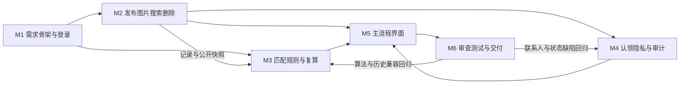

# 02 开发计划

状态：一期实施计划与实际执行记录  
日期：2026-10-27  
依据：[01-spec.md](01-spec.md) 第 1 节至第 11 节，以及本次开发对话中实际发生的需求分析、编码、测试、审查和交付过程。

本计划安排当前本地运行版本：Python 标准库 HTTP 服务、SQLite、原生 HTML/CSS/JavaScript、离线文本匹配模拟器。包含已实现的可选图片上传与展示，不包含注册、图像识别、向量模型、取消认领、规则草稿或下一期进阶项。

里程碑按功能验收分组，实际开发采用“先写需求与关键测试，再实现业务，接入 HTTP/界面，审查后补回归，最后验证交付”的顺序。初始需求和计划在编码前已有简版，本文在开发完成后依实际记录补全；第 4 节的工时是参考预算，不伪装成当时记录的原始估算或实际人工耗时。

## 1. 里程碑

| 编号 | 目标 | 规格依据 | 完成标志 |
| --- | --- | --- | --- |
| M1 | 需求基线、可运行骨架与预置登录 | 第 1、2、6、10、11 节 | 已读取完整题目并形成需求；3 个预置账号能登录/退出；服务端鉴权；SQLite 幂等初始化；Python 单命令启动；无注册接口 |
| M2 | 发布、图片、搜索、软删除 | UC1、UC2、UC6；第 5.1、5.2、5.3、7.1 节 | 新记录为 `open`，图片可选；公开搜索不读取秘密；组合筛选可用；开放记录删除为 `deleted`，关联待审申请驳回并留审计 |
| M3 | 离线匹配、解释、规则与历史复算 | UC3、UC8；第 7.2、7.3 节；验收 3、4、9、10、11 | 0–100 分、置信等级、依据及版本可查看；12 组评测可复现；保存输入快照和规则/引擎版本；v1/v2 历史结果按原算法重算 |
| M4 | 认领、核验、交接、隐私与审计 | UC4、UC5；第 2、5.3、7.4 节；验收 5 至 8 | 特征正确且核验人批准后才保留物品并向双方开放联系人；并发只能有一个成功申请；交接后申请及相关物品共同结案；删除/驳回/结案可追踪 |
| M5 | 主流程界面与浏览器联调 | 第 5.1、6 节；验收 1 至 10 | 广场、发布、详情、匹配、认领、核验、结案和规则管理可点击完成；错误/空结果清楚；真实浏览器回归及手机布局检查通过 |
| M6 | 回归审查、运行说明、文档与交付包 | 第 6、8、10、11 节 | 核心自动测试、AI 评测、源码包独立解压启动有真实结果；README 和过程文档可用；候选人复核、编号和真实录屏另行完成，未完成前不声称正式材料齐备 |

M1–M5 的代码及首轮验证已完成。M6 的工程测试、运行文档和首次源码包验证已完成；当前正按用户逐份提供的模板完善文档，真实录屏、候选人独立人工验收和真实编号仍是待办。

## 2. 任务拆解

| 里程碑 | 任务 | 规格依据 | 实际产物与状态 |
| --- | --- | --- | --- |
| M1 | 阅读题目全部 7 页，确认 T03、核心闭环和交付要求 | 第 1、8、11 节 | 已完成；首轮先形成简版 spec/plan，2026-10-27 完成 `01-spec.md` 模板化修订 |
| M1 | 确定后端/持久化/前端边界及本地运行方式 | 第 5.1、6、11 节 | 已完成；`app.py`、`src/server.py`、`src/static/`，未建立不存在的 FastAPI/Vue 工程 |
| M1 | 建立用户、会话、物品、申请、规则、推荐快照、审计表 | 第 2、5.3、7.1 节 | 已完成；`src/database.py`，SQLite 外键、索引和事务 |
| M1 | 实现 PBKDF2 密码哈希、预置账号登录/退出、会话与 CSRF | 第 2、6 节 | 已完成；`src/service.py`、`src/server.py`；普通用户和管理员由后端鉴权 |
| M1 | 幂等初始化 3 个账号、8 条物品样例、1 个基础规则 | 第 10 节 | 已完成；`python app.py --init-only`，支持独立数据库和 `--no-seed` |
| M2 | 实现字段、日期、长度和招领私密问题/答案校验 | UC1；第 7.1 节 | 已完成；公开文字字段不能直接包含规范化后的秘密答案 |
| M2 | 实现可选 PNG/JPEG/WebP 图片上传和展示 | UC1；第 5.1、6 节 | 已完成；≤500000 字节及签名检查，浏览器回归覆盖上传；不参与匹配 |
| M2 | 实现关键词、类别、地点、日期、状态、类型和本人发布筛选 | UC2 | 已完成；公开检索不扫描秘密或联系人；修正状态中文标签导致提交值错误的缺陷 |
| M2 | 明确不提供发布后编辑，开放记录可带原因软删除 | UC1、UC6；第 5.3 节 | 已完成；`item.deleted` 审计，同事务驳回相关 `pending` 申请 |
| M3 | 先定义匹配评测，再实现无数据库依赖的计分函数 | 第 7.2、7.3 节 | 已完成；`src/matching.py`，Dice、固定同义词、日期间隔、冲突降分和信息不足约束 |
| M3 | 保存规则、源及候选公开快照、完整结果和引擎版本 | UC3；验收 4 | 已完成；`recommendations` 表；快照不含联系人、秘密哈希或图片 |
| M3 | 实现按历史批次 ID 复算及访问权限 | UC3；验收 3、4 | 已完成；生成者/管理员可复算，返回 `identical`；不采用“任意两帖读取当前值”代替历史复算 |
| M3 | 实现管理员五字段权重调整、禁用和追加版本发布 | UC8；验收 9 | 已完成；权重自动归一化，最新整数规则 ID 生效，无持久化草稿 |
| M3 | 保留 v1 原算法，新增 v2 修正食堂同义词行为 | 第 7.2 节 | 已完成；按规则/快照版本实际分派，新增旧规则、新规则及原替换顺序回归 |
| M3 | 建立三类各 4 组的可重复 AI 评测 | 第 5.1、8 节 | 已完成；`tests/fixtures/ai_cases.json`、`scripts/evaluate_ai.py`，共 12 组 |
| M4 | 提交认领、保护申请联系人、可选关联本人开放失物 | UC4；第 7.4 节 | 已完成；未关联失物时仍可填写自己的私密联系人，不保存申请答案明文 |
| M4 | 特征哈希比对后人工批准/驳回，不以得分自动认领 | UC4；验收 5、6 | 已完成；核验人只看特征是否一致，错误特征不能批准，驳回原因必填 |
| M4 | 在事务内批准、保留物品、驳回冲突待审申请 | 第 5.3、6 节 | 已完成；`BEGIN IMMEDIATE` 与部分唯一索引；并发测试验证只有一个成功申请 |
| M4 | 原子更新交接、申请完成及关联物品结案 | UC5 | 已完成；`approved → completed`，`reserved → resolved`；申请者不能自行确认交接 |
| M4 | 联系方式按当前状态与参与关系裁剪，关键操作留审计 | 第 2、7.1、7.4 节 | 已完成；通过前不向对方输出，秘密答案/哈希不从读取接口返回 |
| M4 | 补充旧数据库联系人列升级及关联失物联系人回填 | 第 6、10 节 | 已完成；模拟旧表后连续初始化两次的回归通过，不覆盖已有非空联系人 |
| M5 | 完成 HTML 骨架、CSS 适配和原生 JavaScript 页面逻辑 | 第 5.1、6 节 | 已完成；`index.html`、`styles.css`、`app.js`，Python 提供静态文件，浏览器执行前端代码 |
| M5 | 连接发布、筛选、匹配、认领、核验、交接、规则和审计界面 | 第 5.1 节；验收 1 至 10 | 已完成；登录、发布、详情和确认使用弹窗，没有个人资料或规则草稿页面 |
| M5 | 验证桌面/手机布局、成功/失败/空结果及实际点击链路 | 第 6 节 | 已完成；`tests/browser_smoke.cjs`，系统 Chrome 无头执行并检查截图 |
| M6 | 执行业务、HTTP、匹配和打包清单自动测试及 AI 评测 | 第 6、8 节 | 首轮最终 22 项测试、12 组 AI 评测通过；详情见 `06-test-report.md` |
| M6 | 进行只读 AI 代码审查，发现缺陷先复现再补回归 | 第 6、8 节 | 已完成；隐私、筛选、历史兼容等问题已修复，审查最终通过；过程见 `04-decision-log.md` |
| M6 | 完善 README、配置示例、Windows 启动和交付脚本 | 第 6、11 节 | 已完成；无需第三方运行包；`start.cmd`、`start.ps1`、`config.example` |
| M6 | 独立解压源码包，验证入口、双次初始化、完整测试与评测 | 第 6、8、10 节 | 已完成首轮；修复漏收录 `app.py`，增加清单回归及 `scripts/verify_package.py` |
| M6 | 按用户逐份提供的模板补齐文档 | 第 11 节 | `01-spec.md` 已完成；本次补齐 `02-plan.md`，其他文档的模板化修订待后续逐份进行 |
| M6 | 候选人独立复核、填写编号、录制后续真实过程和最终演示 | 第 6、11 节 | 待完成；此前全程未录制，不能追溯补录为原始过程，索引已如实说明 |

本期不安排注册、图片识别、向量模型、云端说明润色、规则草稿、取消认领、重复帖识别、举报和异常频率提醒。图片上传/展示已经实现，不能沿用模板将其列为“未安排”。

## 3. 依赖关系



图示为功能依赖，不代表先把全部后端写完才开始测试。M3 的纯计分函数和评测集可独立推进，持久化推荐/快照接口依赖 M2 的物品数据；M4 依赖已有物品和身份；M5 在接口可用后联调；M6 审查发现问题后回到相应模块修复。测试和过程文档贯穿所有阶段，外部模型不是任何阶段的前置条件。

实际开发顺序按对话中的工作轮次记录如下，供第 4 节引用：

1. **R1：需求与范围。** 按用户要求建立代码实现 goal，读取 PDF 全部 7 页，确认 T03；编写简版 spec/plan，确定 Python 标准库、SQLite、原生前端和离线匹配方案。
2. **R2：首批测试。** 先写业务与 AI 评测测试，在尚未实现服务/匹配器时实际执行，9 项测试因功能缺失而失败。
3. **R3：核心实现。** 编写数据库、样例、匹配纯函数和业务服务；首批 9 项测试通过，覆盖核验隐私、认领闭环、权限、规则历史和筛选等。
4. **R4：HTTP 与前端。** 新增 HTTP 测试并先确认 5 项因服务未实现而失败；实现会话、路由、前端页面，加入并发回归后形成 15 项通过的初版。
5. **R5：首轮审查与浏览器验证。** 只读审查指出状态筛选值、独立申请联系人、私密答案公开字段重复 3 项问题；补失败回归后修复，使用系统 Chrome 走通发布/图片/匹配/核验/交接/规则/复算及手机布局。
6. **R6：算法与旧数据兼容。** 食堂同义词修复后进一步检查版本漂移，保留 v1、增加 v2 实际分派；补旧联系人列回填，最终审查独立重跑当时的 21 项测试全绿。
7. **R7：交付验证。** 完善首轮架构、接口、决策、协作、测试和录屏缺失说明；实际解压发现打包漏收录根入口，补清单回归后达到 22 项；独立解压双次初始化、22 项测试和 12 组 AI 评测全部通过。
8. **R8：说明与模板修订。** 回答启动/验收及前端运行方式；2026-10-27 按用户模板修订 `01-spec.md`，本轮继续修订 `02-plan.md`。业务代码未因此变更，不将此文档轮次表述为再次完成了全量程序测试。

只有代码审查使用只读 AI 审查代理，不能把它写成额外人员代做或声称整个项目由多人并行实施。完整开发证据为本次对话和工具输出，文档摘要不能代替真实录屏。

## 4. 预计与实际进度

题目给出建议周期 72 小时。本表将 56 小时分配到 6 个里程碑，另留 16 小时用于联调、审查修复、文档与最终录制，作为候选人复核/复现的参考预算。**这是本轮整理时的工作量分配，不是当时已记录的原始排期，也不是本次 AI 开发的实际耗时。**

首次实现从 2026-10-26 的开发会话开始，2026-10-27 继续进行模板化文档修订。没有逐里程碑计时或可关联的录像起止时间，因此实际开始/完成用 R1–R8 轮次描述，不根据文件时间倒推或填造小时数。

| 里程碑 | 预计 | 实际开始 | 实际完成 | 差异说明 |
| --- | --- | --- | --- | --- |
| 文档基线 | 贯穿各阶段，计入 M1/M6 和缓冲 | R1，编码前形成简版 spec/plan | 首轮基础文档于 R7 齐备；R8 已修订规格，本轮补齐计划 | 不是完成代码后才第一次写文档；当前仍按用户顺序等待其他模板，未声称全部文档完成新模板修订 |
| M1 | 6 小时参考预算 | R1 范围/技术选择，R2 核心测试 | R3 完成数据/登录业务，R4 接通 HTTP | 采用标准库、3 账号和无构建前端，未安装 FastAPI/Vue；应用运行无需 Node.js |
| M2 | 8 小时参考预算 | R2 首批业务规则测试 | R3 完成主体，R5 完成筛选/私密字段缺陷修复 | 包含真实图片上传/展示；删除为 `deleted`，关联待审申请为 `rejected`，没有 `cancelled` 状态 |
| M3 | 12 小时参考预算 | R2 评测和历史复算测试 | R3 完成初版，R6 完成 v1/v2 历史兼容 | 使用 Dice、整数规则 ID 和快照复算；没有阈值/同义词草稿及云端模型润色；新旧引擎均实际保留 |
| M4 | 10 小时参考预算 | R2 隐私/认领/交接测试 | R4 完成初版集成，R5–R6 完成联系人与旧表兼容修复 | 冲突申请在批准时即驳回；成功后保留物品，交接后结案；不能取消申请或撤销核验 |
| M5 | 12 小时参考预算 | R4 编写原生前端并连接接口 | R5 完成主流程，R6 后再次通过浏览器回归 | 系统 Chrome + Playwright 验证；桌面/手机截图由 AI 查看，未替候选人宣称独立人工验收 |
| M6 | 8 小时参考预算 | R1 起写过程文档，R4 起集成验证 | R7 完成工程验证与首次源码包；R8 仍进行文档完善 | 自动测试 22 项、AI 评测 12 组、源码包解压验证均有真实结果；真实录屏/编号/候选人复核待办，正式交付不能标为全部完成 |
| 缓冲与正式提交 | 16 小时参考预算 | 未记录独立耗时 | 候选人复核、后续真实录制、剩余模板修订和重打包待安排 | 预算不是已发生的工作量，不能声称缺失的原始全程录屏可在缓冲中补回 |

实际验收结果由命令输出支撑，不以预算消耗或“预计完成”代替通过。相关结果见 [06-test-report.md](06-test-report.md)。

后续待办按依赖顺序安排：

1. 继续按用户逐份提供的样板完善其余 docs，保持与已修订规格及代码一致。
2. 候选人独立按 README 启动、解释核心实现、复核主流程和已知限制，填写真实候选人编号。
3. 如实录制后续复核/修改过程和最终演示，更新真实索引；不能把新录制内容冒充此前缺失的全程记录。
4. 文档齐备后重新生成源码包，并对最终提交包执行独立解压验证。此前生成的 ZIP 不会随 `01-spec.md`、`02-plan.md` 更新而自动改变，不应直接当作最新版提交。

## 5. 风险

| 风险 | 影响 | 应对 |
| --- | --- | --- |
| 模板描述与实际技术栈/状态不一致 | 文档声称 FastAPI/Vue、4 账号、取消认领等，但无法演示 | 以当前代码和修订后的规格核对；保留模板章节但替换不适用内容；不将模板内容当作新开发指令 |
| 公开接口泄露联系人或秘密特征 | 增加冒领风险，隐私验收失败 | 对外响应裁剪字段，秘密哈希不返回；特征正确性仅核验人可见；补公开读取、通过前后和错误特征回归 |
| 私密答案直接出现在公开颜色/地点/日期中 | 无需知道未公开特征也能回答问题 | 检查所有公开文字字段的规范化答案重复；已补回归；图片泄密及语义暗示仍需发布者人工检查 |
| 并发批准或关联失物重复处理 | 同一物品多个成功申请、状态不同步 | `BEGIN IMMEDIATE` 内重查、部分唯一索引、关联记录更新及冲突待审驳回同事务，执行两线程回归 |
| 算法修复后沿用旧引擎版本 | 同一历史快照分数从 97 变 100，追溯失效 | 修正算法使用 v2，完整保留 v1 行为及替换顺序；规则执行与快照复算按保存版本分派 |
| 旧数据库只补列、不回填已有联系人 | 旧的已批准/已完成申请失去交接信息 | 初始化时幂等从关联失物回填空联系人，保留已有非空值，模拟旧表双次初始化测试 |
| 词表外改写或相似外观误导匹配 | 正确记录低分或错误记录仍进入候选 | 字段冲突降分、信息不足明确说明、不自动认领；12 组评测固定验收，未覆盖真实准确率的限制写入报告 |
| AI 无密钥或无法联网 | 若强依赖云服务会影响现场验收 | 当前默认离线模拟器，无外部配置和费用；浏览器实际链路不依赖远程模型 |
| 浏览器工具配置不可用 | 界面不能得到实际验证 | BrowserAct 不可用时改用本地系统 Chrome + Playwright；开发依赖与应用运行依赖分开说明 |
| 打包清单遗漏启动入口或夹带运行数据 | 评审解压无法启动，或提交缓存/个人数据 | 白名单含 `app.py`，增加 `test_package.py`，ZIP CRC/路径检查，独立解压双次初始化和全量测试；排除数据库、缓存和依赖目录 |
| 文档更新后提交旧 ZIP | 包内规格与当前文件夹不一致 | 等本轮文档全部修订后重新打包，再验证最终包；不因之前包验证通过就跳过最后同步 |
| 将未测性能或安全边界写成已达成 | 验收承诺无法复现 | 明确 500 条列表/候选上限，未做大规模压测、生产认证或完整图像扫描，不承诺 1000 条/3 秒 |
| 原始开发过程没有录屏 | 正式交付材料缺口，无法还原完整屏幕过程 | 索引真实说明，候选人从后续实际过程开始录制并按招聘方要求处理缺失；不将其标为已完成或可追溯补录 |

## 6. 验证安排

下表的“已执行”引用本次先前开发会话中的真实结果。此次只修订计划文档，进行文档结构/引用核对，不冒充再次运行全部测试或浏览器。

| 时机 | 验证 |
| --- | --- |
| 编码前及规则变更前 | 已执行：首批 9 项业务/匹配测试因功能未实现而失败；5 项 HTTP 测试同样先确认未实现失败；审查问题先复现/补失败回归后修复。不能将单纯写出测试当作通过证据 |
| M1 结束 | 已执行：预置账号登录、会话 cookie、CSRF、注销失效、跨站请求拒绝和普通用户管理越权检查；初始化不重复创建样例；无注册业务路径 |
| M2 结束 | 已执行：发布必填/日期/秘密字段校验，关键词/类别/地点/日期/状态组合筛选，公开字段保护，软删除及审计；浏览器状态筛选回归先复现预期 8 条实际 0 条，再修正通过 |
| M3 结束 | 已执行：纯匹配函数与确定性、信息不足/冲突分数、12 组标签评测、规则发布权限与非法权重、原候选删除/新规则发布后的历史复算；旧引擎 97 分、新引擎 100 分分别保持一致 |
| M4 结束 | 已执行：错误特征不能批准，自认领/重复申请/越权被拒绝，未关联失物的联系人保护，关联失物联动保留与结案，申请人不能确认交接；并发只有一个获批申请；旧表联系人升级两次幂等 |
| M5 结束 | 已执行：`tests/browser_smoke.cjs` 使用独立临时数据库实际点击/填写/上传，覆盖发布图片、筛选、匹配、联系人隐藏、申请、批准、交接、规则发布和历史复算；0 页面 JS 错误，390×844 无横向溢出，并查看桌面/手机截图 |
| M6 核心自动化 | 已执行：`python -m unittest discover -s tests -v` 最终 22/22，通过项为 13 业务、5 HTTP、3 匹配、1 打包清单；`python scripts/evaluate_ai.py` 为 12/12；非 pytest 项目 |
| M6 语法检查 | 已执行：`node --check src/static/app.js`、`python -m compileall -q app.py src tests scripts` 均退出码 0；Node.js 只在这些开发检查和可选浏览器回归中使用 |
| M6 独立交付验证 | 已执行首轮：生成源码包、独立临时目录解压、两次初始化，仍为 8 物品/3 用户/1 规则；解压项目运行 22 项测试与 12 组评测全部通过，临时 SQLite 连接关闭后清理目录 |
| R8 文档修订 | `01-spec.md` 已检查全部标题骨架一致、11 节/8 用例/3 状态图和本地链接有效；本次 `02-plan.md` 按相同原则核对，保留模板 7 节及依赖图，引用首轮结果而不重新编造过程 |
| 正式提交前 | 待执行：候选人独立人工验收、源码解释、真实编号、剩余文档模板修订、后续真实录制及最终 ZIP 重打包/复验；依据 `demo-guide.md` 更新真实录屏索引 |

可复现命令：

```powershell
# 应用启动，不安装第三方运行依赖
python app.py

# 核心自动测试与 AI 评测
python -m unittest discover -s tests -v
python scripts/evaluate_ai.py

# 可选开发检查；浏览器回归需 Node.js、Playwright 与可用浏览器
node --check src/static/app.js
node tests/browser_smoke.cjs

# 最终文档齐备后重新生成并验证正式源码包
python scripts/package.py --candidate-id 你的候选人编号
python scripts/verify_package.py output/你的候选人编号_T03_失物招领.zip
```

Playwright 安装/复用、`BROWSER_EXECUTABLE`、`PLAYWRIGHT_MODULE` 和 Python 选择方法见 [README](../README.md)。构造样例通过率仅代表测试集符合率，不等于真实校园检索准确率。未测试的生产部署、真实移动设备、大规模负载及断电/磁盘故障等范围见 [测试报告](06-test-report.md)。

## 7. 计划变更记录

以下区分初始方案、实现修正和本轮文档适配，不把样板中与当前项目不一致的安排写成本项目曾经实施过的路线。

| 编号 | 时点 | 类型与触发 | 调整及原因 | 影响与验证 |
| --- | --- | --- | --- | --- |
| P01 | R1 | 初始方案确定 | 根据本地复现和无付费验收要求，选择 Python 标准库 + SQLite + 原生前端，以及确定性离线文本匹配 | 不是从 FastAPI/Vue 重构而来；运行无需 Node.js、框架安装或模型密钥，基础测试与浏览器验证通过 |
| P02 | R5 | 验证工具调整 | BrowserAct 没有可用配置，改用环境现有系统 Chrome 和 Playwright | 不引入应用运行依赖；真实浏览器主流程及手机布局通过，无需在线浏览器服务 |
| P03 | R5 | 缺陷修复：状态筛选 | 中文选项没有显式 `value`，筛选时向后端提交中文而非状态代码；改为显式绑定 | 浏览器回归先出现 0 条而预期 8 条，修复后通过；业务状态定义未改变 |
| P04 | R5 | 数据/隐私补齐：独立认领联系人 | 首版不关联失物时无法给拾获者提供认领人联系人，增加私密 `applicant_contact` | 增加幂等列升级、通过前隐藏/通过后双方开放，补核心及浏览器回归 |
| P05 | R5 | 隐私校验扩展 | 首版仅防止答案出现在标题/描述/问题，审查发现颜色、地点、日期等也会暴露答案 | 扩展全部公开文字字段检查，新增失败回归后修复；图片仍需人工复核 |
| P06 | R5–R6 | 算法及历史兼容 | 食堂同义词重复替换需修复，不能沿用原引擎版本导致历史结果漂移 | 新增 v2，完整保留 v1 及顺序；规则和快照按版本分派，旧批次复算和新规则测试通过 |
| P07 | R6 | 旧库数据兼容 | 新增联系人列仅置空会使旧关联申请失去原有联系人展示 | 从关联失物幂等回填，保留非空值；模拟旧表后两次初始化回归通过 |
| P08 | R7 | 交付缺陷修复 | 独立解压发现白名单漏收录根目录 `app.py`，补入口及可验证的文件清单 | 新增打包回归，测试数由 21 增至 22；最终独立解压启动、幂等初始化、全量测试与评测通过 |
| P09 | R7 至今 | 交付缺口记录 | 原始开发全程未录屏，未生成最终演示视频 | 如实保留未完成项和索引，不写成用户取消需求；待候选人录制后续真实过程，并按招聘方要求处理既往缺失 |
| P10 | R8 / 2026-10-27 | 用户要求的文档形式完善 | 按样板先修订规格，再修订本计划，保留章节结构并用当前代码/真实过程替换不适用内容 | 不增加注册、取消认领、草稿、云模型等能力；不编造各阶段小时数；其余模板逐份处理后再同步最终源码包 |

后续若实际改变功能、算法、状态或交付范围，应新增记录，说明触发、实现、测试及文档同步结果。仅计划或尚未执行的工作保持待办，不追认成已经完成的开发事实。
