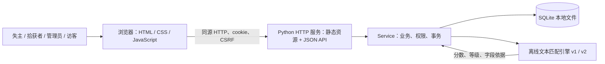
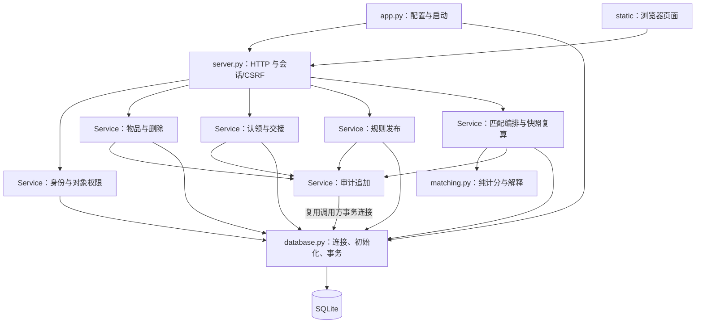
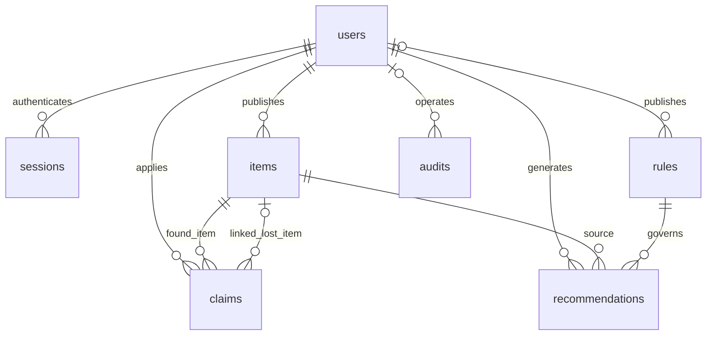
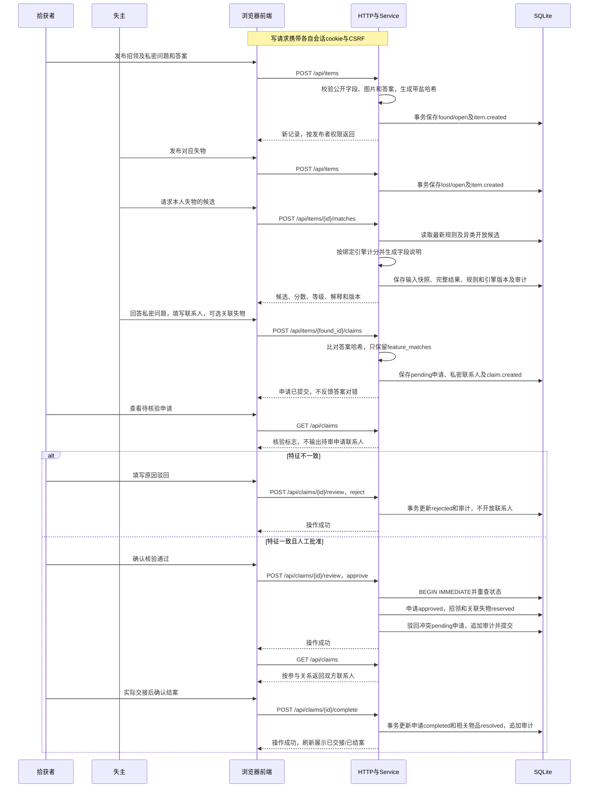
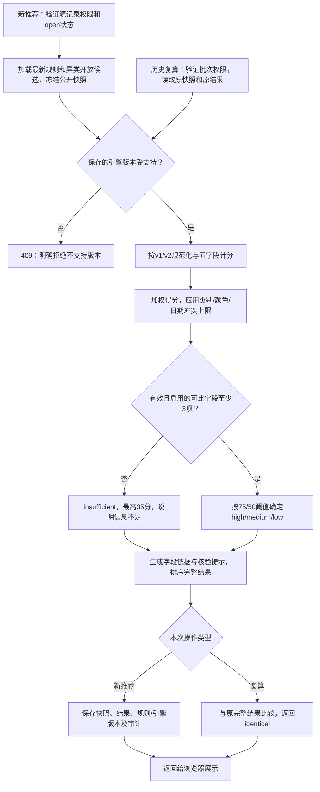

# 03 架构设计

状态：一期当前实现架构  
日期：2026-10-27  
依据：[01-spec.md](01-spec.md) 与[02-plan.md](02-plan.md)。字段、计分、信息不足及状态迁移以规格第 2、5.3、7.1、7.2、7.3、7.4 节为准，本文件说明它们如何在现有代码中实现。

本文保留模板的 8 个主章节；数据模型按实际表名展开，补充会话表。仅描述当前实现，不把模板中的框架、草稿、取消或外部模型路径写成已存在的组件。

## 1. 系统上下文

评审在本机执行 `python app.py`，启动一个 Python 服务进程。该进程使用标准库 `ThreadingHTTPServer`，同时提供静态前端和 `/api` JSON 接口，默认监听 `127.0.0.1:8000`。浏览器是客户端，不需要另起 Vue/Vite 开发服务器，也没有前端代理端口。

浏览器加载 `/` 对应的 HTML 后，再请求 CSS 和 JavaScript。`app.js` 在浏览器中执行，使用 `fetch` 访问同源 API，将数据渲染为卡片、表单、匹配结果和管理页面。前后端通过 HTTP 分层，部署时共享一个服务入口。

Python 进程在本机读写 SQLite 文件；匹配在该进程内按规则绑定的引擎计算。系统不调用云端 AI、向量服务或远程图片存储。图片以受大小限制的 data URL 随记录存入 SQLite，仅供展示。



系统边界：访客可浏览公开信息；登录用户处理自己的发布/认领；管理员管理规则、核验与审计。真实校园身份、物权判断、短信/邮件、即时通讯和线上托管不在当前系统内。Node.js 仅用于可选开发检查和浏览器回归，不是应用运行依赖。

## 2. 模块图

以下是实际文件与职责的对应，不表示已经拆成多个独立服务或后台进程。

| 模块 | 实际位置 | 职责 |
| --- | --- | --- |
| 启动与配置 | `app.py` | 解析 CLI/环境变量，选择数据库，执行初始化，启动/停止 HTTP 服务，配置控制台日志 |
| 前端骨架 | `src/static/index.html` | 导航、主要内容容器、账号区域、弹窗和提示容器，引用 CSS/JS |
| 前端样式与交互 | `src/static/styles.css`、`src/static/app.js` | 布局和手机适配、页面生成、表单校验反馈、账号切换、API 请求及错误提示 |
| HTTP 接入 | `src/server.py` 的 `Handler`、`make_server` | 静态文件白名单、JSON 体积/形状、Host/Origin、会话/CSRF、路由、统一响应及请求日志 |
| 身份与对象权限 | `src/service.py` 的 `login/session/logout`、`_require_user/_admin/_manage` | 用户校验、会话持久化、登录状态恢复和对象级权限 |
| 物品业务 | `Service.create_item/list_items/get_item/delete_item` | 发布、字段/图片校验、搜索、联系人裁剪、软删除及待审申请联动 |
| 认领业务 | `Service.create_claim/list_claims/review_claim/close_claim` | 私密特征比对、申请去重、人工核验、保留物品、冲突驳回、交接结案及联系人输出 |
| 规则业务 | `Service.list_rules/publish_rule` | 校验权重、归一化、追加发布版本，读取最新/历史版本；无草稿存储 |
| 匹配编排 | `Service.recommend/_snapshot/_calculate/list_recommendations/recompute` | 选择源/候选，冻结公开输入，按版本调用纯函数，保存推荐和历史复算 |
| 纯匹配与解释 | `src/matching.py` | 规范化、同义词、Dice/结构化字段计分、冲突降分、置信等级和字段说明；版本化算法分派 |
| 数据库与事务 | `src/database.py` 的 `Database` | 表/索引创建、旧列升级与回填、SQLite 连接、读连接和写事务生命周期 |
| 审计 | `Service._audit/_reject/list_audits` | 在业务所用连接中追加必要事件，管理员查询最近审计；无修改/删除接口 |
| 测试与交付 | `tests/`、`scripts/` | 业务/HTTP/匹配/打包清单回归、浏览器联调、AI 评测及源码包生成/解压验证 |



`Service` 中的物品、认领、规则和匹配是逻辑职责，目前位于同一文件；不存在 `post_service.py`、`explainer.py` 等额外组件。状态更新集中在业务服务，HTTP 层不直接执行状态 SQL。

匹配纯函数只接收公开字段、权重和显式引擎版本，不访问数据库、网络、用户秘密或当前时间。说明文字也在该纯函数中生成，没有外部润色链。每次数据库操作使用自己的连接，连接不跨请求线程共享。

## 3. 数据模型

实际共有 7 张业务表：`users`、`sessions`、`items`、`claims`、`rules`、`recommendations`、`audits`，定义见 [database.py](../src/database.py)。模板的帖子、推荐、规则、审计概念分别对应这里的 `items`、`recommendations`、`rules`、`audits`，不另建同名模板表。

除会话令牌哈希作为主键外，其余主键为 SQLite `INTEGER PRIMARY KEY`。创建/更新时间存带 UTC 时区的 ISO 文本；会话过期为 Unix 秒；物品发生日期为 `YYYY-MM-DD` 文本。状态使用规格中的小写枚举。



### users

| 字段 | 类型 | 约束与含义 |
| --- | --- | --- |
| `id` | INTEGER | 主键 |
| `username` | TEXT | 非空、唯一，预置登录名 |
| `name` | TEXT | 非空，界面显示名 |
| `role` | TEXT | 非空，只能为 `user` 或 `admin` |
| `password_hash` | TEXT | 非空，带盐 PBKDF2-HMAC-SHA256 编码 |

初始写入 `alice`、`bob`、`admin`。用户表没有电话、微信、创建时间或账号级联系人字段，没有注册或个人资料更新接口；联系方式随物品/申请保存。登录 JSON 不输出密码哈希。

### sessions

| 字段 | 类型 | 约束与含义 |
| --- | --- | --- |
| `token_hash` | TEXT | 主键，随机会话令牌的 SHA256，不保存原令牌 |
| `user_id` | INTEGER | 非空，外键 `users.id` |
| `csrf` | TEXT | 非空，供当前会话写请求校验的随机值 |
| `expires_at` | INTEGER | 非空，过期 Unix 秒；登录后有效 12 小时 |

原始会话令牌通过 HttpOnly cookie 交给浏览器，响应 JSON 返回用户信息和 CSRF。服务端按令牌哈希和过期时间恢复用户；退出删除当前会话，后续登录时清理已过期会话。没有 JWT、刷新令牌或环境变量签名密钥。

### items

| 字段 | 类型 | 约束与含义 |
| --- | --- | --- |
| `id` | INTEGER | 主键，物品记录 ID |
| `owner_id` | INTEGER | 非空，外键 `users.id`，发布者 |
| `kind` | TEXT | 非空，`lost` 或 `found` |
| `title` | TEXT | 非空，标题，应用限制 80 字 |
| `category` | TEXT | 非空，应用校验 8 类固定枚举 |
| `date_from` | TEXT | 非空，发生日期起点 |
| `date_to` | TEXT | 非空，发生日期终点，不早于起点 |
| `location` | TEXT | 非空，自由文本地点，最长 100 字 |
| `color` | TEXT | 非空，自由文本颜色，最长 30 字，可填未知值 |
| `description` | TEXT | 非空，公开描述，最长 2000 字 |
| `contact` | TEXT | 非空，受保护联系人，最长 150 字 |
| `secret_question` | TEXT | 非空、默认空串，招领的公开核验问题 |
| `secret_hash` | TEXT | 非空、默认空串，招领预设答案哈希，从不对外读取 |
| `image` | TEXT | 非空、默认空串，可选 PNG/JPEG/WebP data URL |
| `status` | TEXT | 非空、默认 `open`，只能为 `open/reserved/resolved/deleted` |
| `created_at` | TEXT | 非空，服务端创建时间 |

招领必须填写一个问题和答案；失物不保存这两个核验字段。秘密答案不会明文入表。图片存储在本表，没有图片表或上传目录，解码大小和魔数由业务层校验。发布之后不提供业务字段更新，删除仅改变状态。

普通读取总是移除 `secret_hash`，`contact` 按当前会话与参与关系决定是否返回。`deleted` 不在列表、新匹配或普通详情中返回。发生日期与长度限制主要由应用校验，并非全部写成 SQL CHECK。

### claims

| 字段 | 类型 | 约束与含义 |
| --- | --- | --- |
| `id` | INTEGER | 主键，申请 ID |
| `item_id` | INTEGER | 非空，外键 `items.id`，被认领的招领 |
| `applicant_id` | INTEGER | 非空，外键 `users.id`，申请者 |
| `lost_item_id` | INTEGER | 可空，外键 `items.id`，申请者关联的本人失物 |
| `feature_matches` | INTEGER | 非空，应用写入 0/1，表示规范化答案是否与预设一致 |
| `note` | TEXT | 非空，申请备注，允许空串 |
| `applicant_contact` | TEXT | 非空、默认空串，受保护的申请人联系人 |
| `review_note` | TEXT | 非空、默认空串，审核说明/驳回原因 |
| `status` | TEXT | 非空、默认 `pending`，只能为 `pending/approved/rejected/completed` |
| `created_at` | TEXT | 非空，提交时间 |
| `updated_at` | TEXT | 非空，最近处理时间 |

唯一约束为 `(item_id, applicant_id)`，同一用户不能对同一招领重复申请，包括已驳回的情况。部分唯一索引 `one_winner` 约束同一 `item_id` 最多一个 `approved` 或 `completed` 申请。

申请答案只在请求内用于哈希比对，不存 `secret_answer` 明文；没有取消状态、核验人 ID、独立通过/结案时间列。操作者和动作时间通过审计追踪，审核说明保存在申请行。

`feature_matches` 只向招领发布者及管理员输出；申请人看不到该标志。申请中的 `applicant_contact` 在 `pending/rejected` 时从列表响应移除，在 `approved/completed` 时向有权参与者返回，同时返回拾获者联系人。管理员对物品联系人有管理读取权限，不能据此绕过“特征错误禁止批准”的业务约束。

### recommendations

| 字段 | 类型 | 约束与含义 |
| --- | --- | --- |
| `id` | INTEGER | 主键，每次生成一个推荐批次 |
| `user_id` | INTEGER | 非空，外键 `users.id`，发起者 |
| `source_id` | INTEGER | 非空，外键 `items.id`，源物品 |
| `rule_id` | INTEGER | 非空，外键 `rules.id`，当时规则版本 |
| `snapshot` | TEXT | 非空，输入快照 JSON |
| `results` | TEXT | 非空，排序后的完整结果 JSON |
| `created_at` | TEXT | 非空，批次创建时间 |

`snapshot` 包含 `engine_version`、`weights`、`source`、`candidates`。每个源/候选对象只保存 `id/title/kind/category/location/color/description/date_from/date_to`，不含联系人、秘密哈希、核验问题或图片。

`results` 每项包含 `candidate_id/title/score/confidence/fields/explanation`。信息不足仍作为一项结果，标记 `insufficient`，不是另建 `REFUSE` 行。同一对物品可在不同请求中生成多个批次，没有“源+目标+规则只保留一行”的唯一约束，也没有 `input_hash` 或模型展示说明字段。

复算按批次权限取出原快照，调用原引擎，比较完整结果并返回 `identical`。原物品的软删除或结案不会改写快照；原候选当前详情可能不可再读取，但历史复算仍可进行。

### rules

| 字段 | 类型 | 约束与含义 |
| --- | --- | --- |
| `id` | INTEGER | 主键、整数规则版本，界面显示为 `v{id}` |
| `name` | TEXT | 非空，版本说明 |
| `weights` | TEXT | 非空，五字段归一化权重 JSON |
| `engine_version` | TEXT | 非空，实际绑定的算法版本 |
| `created_by` | INTEGER | 可空，外键 `users.id`；初始化规则为系统创建 |
| `created_at` | TEXT | 非空，创建/发布时刻 |

当前最大 ID 的规则对新匹配生效，没有 `DRAFT/PUBLISHED`、`is_active`、`published_at` 或独立字符串版本号。发布前表单只在浏览器内，提交成功即追加版本，不支持保存草稿或修改已发布记录。

权重为 0 表示禁用。API 接受各字段 0–100 的有限数，至少一项大于 0，自动除以总和后保存。阈值、同义词、最少有效字段数由引擎代码决定，不存为管理员可编辑规则正文。规则序号 `v1` 与算法字符串 `offline-text-v1` 是不同概念。

### audits

| 字段 | 类型 | 约束与含义 |
| --- | --- | --- |
| `id` | INTEGER | 主键，审计序号 |
| `actor_id` | INTEGER | 可空，外键 `users.id`；系统初始化可为空 |
| `action` | TEXT | 非空，动作名 |
| `entity_type` | TEXT | 非空，`item/claim/rule/recommendation/user/system` 等对象类型 |
| `entity_id` | INTEGER | 可空，对象编号；不是指向单张表的固定外键 |
| `detail` | TEXT | 非空，必要说明 JSON |
| `created_at` | TEXT | 非空，事件时间 |

实际动作包括 `system.seeded`、`auth.login`、`item.created`、`item.deleted`、`item.reserved`、`item.resolved`、`claim.created`、`claim.rejected`、`claim.approved`、`claim.completed`、`rule.published`、`matching.generated`。

状态变化的 `from/to`、处理原因、关联申请 ID 或规则权重等放在 `detail`，不是独立 `from_status/to_status` 列。服务不主动将密码、原始秘密答案、会话令牌或联系人写入审计；用户也不应在公开描述/备注中混入无关隐私。

业务代码只追加审计，不提供修改/删除 API；这不等于对直接访问数据库文件的人提供防篡改保证。管理员读取最近 500 条，可按对象 ID 人工定位；没有普通用户审计接口、按帖过滤或导出功能。

数据库连接启用外键、15 秒等待和 WAL 模式。核心写操作用 `BEGIN IMMEDIATE`，出错回滚后关闭连接，成功提交后关闭连接。索引还包括 `item_filters(status,kind,category,date_from,date_to)` 与 `claim_applicant(applicant_id,status)`。旧申请缺少联系人列时补列，并从关联失物回填空值，保留非空值；无法恢复从未保存且没有关联失物的历史联系人。

## 4. 关键接口

浏览器使用同源会话 cookie `campus_session`，没有 `Authorization: Bearer`。除登录外，所有已实现的写接口要求有效会话及 `X-CSRF-Token`；写请求体为 JSON 对象，`Content-Type: application/json`。浏览器登录后从返回值取得 CSRF，刷新页面通过 `/api/session` 恢复。

成功响应为 `{ "data": ... }`。错误响应为 `{ "error": { "message": "原因", "request_id": "请求编号" } }`；HTTP 状态表示错误类别，没有独立的 `error.code` 字段。

| 方法 | 路径 | 输入及说明 | 权限/结果 |
| --- | --- | --- | --- |
| GET | `/api/health` | 服务状态和默认引擎版本 | 公开，200 |
| GET | `/api/meta` | 类别、默认引擎和 AI 模式 | 公开，200 |
| GET | `/api/session` | 当前 cookie 对应用户、CSRF；未登录返回 null 用户 | 公开调用，200 |
| POST | `/api/login` | `username/password`，返回用户/CSRF并设置 cookie | 预置账号，200；JSON 不含令牌 |
| POST | `/api/logout` | 空对象，删除当前会话并清 cookie | 登录+CSRF，200 |
| GET | `/api/items` | `q/kind/category/location/date_from/date_to/status/mine` | 公开读取；`mine` 要求登录；最多 500 条 |
| POST | `/api/items` | 发布字段、受保护联系人、可选图片；招领要求秘密问题/答案 | 登录+CSRF，201 |
| GET | `/api/items/{id}` | 单条详情，联系人依身份裁剪 | 公开调用；删除/不存在为 404 |
| DELETE | `/api/items/{id}` | JSON `reason`，软删除并处理待审申请 | 发布者/管理员+CSRF，200，仅 `open` |
| POST | `/api/items/{id}/matches` | 空对象，生成并保存新推荐批次 | 发布者/管理员+CSRF，201，仅 `open` |
| POST | `/api/items/{id}/claims` | `answer/contact/note?/lost_item_id?` | 登录+CSRF，201，仅他人开放招领 |
| GET | `/api/claims` | 自己提交或自己的招领收到的申请 | 登录；管理员全部；无 incoming/outgoing 参数分箱 |
| POST | `/api/claims/{id}/review` | `decision=approve/reject`、`note`；驳回必须说明 | 招领发布者/管理员+CSRF，200；批准要求特征一致 |
| POST | `/api/claims/{id}/complete` | 空对象，确认实际交接 | 招领发布者/管理员+CSRF，200 |
| GET | `/api/rules` | 最新在前的完整规则列表 | 公开，200 |
| POST | `/api/rules` | `name/weights`，校验并追加版本 | 管理员+CSRF，201 |
| GET | `/api/recommendations` | 推荐历史摘要 | 登录；本人最近 100 条，管理员可看全部范围内最近 100 条 |
| POST | `/api/recommendations/{id}/recompute` | 空对象，按原快照复算 | 生成者/管理员+CSRF，200，含 `identical` |
| GET | `/api/audits` | 最近 500 条审计 | 仅管理员，200 |

发布字段、样例和长度限制见 [api.md](api.md) 与规格 UC1。推荐生成和复算使用 POST，前者会保存批次，不能沿用模板写成 GET 计算。当前没有账号联系人修改、保密详情专用路由、单申请详情、取消、规则草稿、按字符串规则号读取或普通用户审计路径。

已实现路由的错误类别：400 为参数/业务约束，401 为未登录，403 为对象权限/CSRF/同源校验，404 为不存在，409 为部分状态或版本冲突，413 为超过请求大小，415 为内容类型不符，500 为未处理内部异常。例如重复申请、审批时状态变化、非获批申请交接和不支持引擎返回 409；对仍可读取的非开放记录新申请、删除保留/结案记录或错误特征批准返回 400。已删除记录先按不存在返回 404，不笼统声称所有非法状态都为 409。

健康/元数据中的默认引擎版本不表示旧规则已升级。实际推荐使用哪个版本，应以该批次的 `engine_version` 为准。

## 5. 主流程时序



管理员可替代拾获者执行核验/交接，仍必须满足特征和状态条件；申请者不能自行结案。批准时就处理冲突待审申请，交接时不再延后做这一步。

事务边界如下：

| 操作 | 同一事务内完成的内容 |
| --- | --- |
| 发布 | 新建物品、追加 `item.created` |
| 提交认领 | 检查招领/关联失物、避免重复，写入特征结果和联系人，追加 `claim.created` |
| 核验通过 | 重查权限/状态/特征，申请 `approved`，相关物品 `reserved`，冲突待审申请驳回，对应审计一起提交 |
| 驳回 | 待审申请 `rejected`、保存原因和更新时间、追加审计；物品保持原开放状态 |
| 确认交接 | 申请 `completed`、招领与关联失物 `resolved`、对应审计一起提交 |
| 删除 | 仅开放记录变 `deleted`，相关待审申请驳回，删除原因与状态审计保留 |
| 发布规则 | 新增不可修改的规则版本，追加 `rule.published` |
| 生成推荐 | 在同一写事务中读取所用规则/记录、计算和保存快照/结果、追加 `matching.generated` |

写事务异常回滚，不产生半完成的状态联动。`reserved/resolved` 物品不能删除；不提供取消认领、撤销核验、`reserved → open` 或结案重开流程。状态图及具体迁移见规格第 5.3 节。

## 6. AI 调用链

该组件是题目允许的可复现离线文本匹配模拟器，不是云端大模型。新推荐与历史复算共用纯计算链，但读取输入、版本及结果处理不同。



计分输入仅为第 3 节的公开快照、归一化权重和显式引擎版本；算法不读取图片、联系人、秘密答案、网络或当前时刻。默认权重为类别 25%、地点 20%、颜色 15%、时间 15%、描述 25%。

描述和地点在规范化后，完全相同取 1、包含取 0.85，其余取字符二元组 Dice；类别/颜色取规范化后的精确一致性；日期重叠为 1，否则按最近间隔天数衰减。缺失/未知字段贡献 0，不按剩余可比权重重新归一化。字段值保存到 6 位小数，总分应用约束后保留 2 位小数；具体公式以规格第 7.2 节为准。

类别冲突最高 30，颜色/日期冲突最高 49；有效启用字段少于 3 项时为 `insufficient` 且最高 35。其他情况按未进行最终展示舍入的总分分档：≥75 为 high，≥50 为 medium，其余 low。信息不足的候选仍返回，不另存无目标的拒绝行。

每次最多读取 500 条候选，按得分降序、候选 ID 升序排序；没有最低分过滤或 top-10 截断。匹配计算位于当前 `BEGIN IMMEDIATE` 事务内，小规模本地数据便于保证快照一致，但也会占用写锁；没有大规模性能保证。

规则发布绑定当前 `offline-text-v2`；旧规则可继续绑定 `offline-text-v1`。v1 完整保留原食堂同义词替换和顺序，v2 修正重复前缀。新推荐按规则版本调用，历史复算按快照版本调用；规则序号不会代替算法版本。后续算法变化应新增版本并保留旧实现，不能覆盖旧算法后声称仍可复现。

解释由实际字段分项和冲突/信息不足依据组成，始终提示核验未公开特征。没有 `LLM_BASE_URL/LLM_API_KEY/LLM_MODEL` 配置，没有 8 秒模型超时、模型润色或单独 `explanation_display`；离线说明即正常路径。评测脚本直接调用纯函数，12 组样例的通过率不代表真实物品归属概率或真实校园准确率。

## 7. 安全与失败降级

| 场景 | 实际行为 |
| --- | --- |
| 没有 AI 密钥或网络 | 本地模拟器照常返回分数、等级和字段说明，不需要配置外部模型或触发额外降级开关 |
| 无匹配候选 | 保存该次空候选批次，界面提示暂无候选，不生成虚假的匹配 |
| 字段信息不足或相互冲突 | 按固定约束降分/标记 `insufficient` 并解释，不自动判定归属 |
| 无会话/会话过期 | 需登录的业务返回 401；公开浏览继续允许；不存在自动刷新令牌流程 |
| 无对象权限或 CSRF 不符 | 返回 403，业务不执行；普通用户不能通过修改前端角色获得管理员权限 |
| 不受支持的 Host 或跨站写请求 | Host 必须为本地允许地址和实际端口；若写请求带 Origin，则必须与本地 HTTP 来源一致，否则 403 |
| 无效 JSON、字段或日期 | 已实现接口返回 400；非 JSON 内容类型 415，请求体超过 800000 字节 413 |
| 图片超过限制或签名不符 | 返回 400，物品不创建；不宣称已完整解码或扫描图片内容 |
| 错误私密特征要求批准 | 返回 400，不能使用管理员权限绕过；申请不会被自动通过 |
| 重复申请、审核/交接时状态变化 | 按实际路径返回 409；其他部分业务限制返回 400，事务异常回滚 |
| 权重非法、非有限数、全零或未知字段 | 返回 400，不追加规则；合法权重自动归一化，不要求输入之和恰为 100 |
| 历史引擎不受支持 | 返回 409，拒绝用当前算法冒充历史复算；当前支持 v1/v2 |
| SQLite 写入繁忙 | 最多等待约 15 秒；若仍抛数据库异常，由通用错误分支返回 500 并记录日志；没有专门的 503 映射或自动重试 |
| 其他内部异常 | 返回不含堆栈的通用错误及请求 ID，控制台记录异常；前端显示错误，不假装操作成功 |

密码和预设秘密答案均用随机盐、120000 次 PBKDF2-HMAC-SHA256；哈希比较使用恒定时间比较。登录令牌为随机值，仅 SHA256 哈希入库，有效期和 cookie Max-Age 均为 43200 秒（12 小时）。cookie 设置 HttpOnly、SameSite=Strict、Path=/；本地使用 HTTP，没有生产 HTTPS/Secure cookie 配置。

服务不使用 JWT 或 `change-me` 签名密钥。CSRF 在会话中保存，供前端写请求携带；退出删除当前令牌对应会话。联系人和公开输入在 SQLite 中并非静态加密，仅通过服务端访问控制裁剪，不能据此声称数据库文件本身已加密。

HTTP 层只允许 `/`、`/app.js`、`/styles.css` 三个静态入口，不开放项目目录、数据库或任意文件下载。SQL 使用参数化值；响应设置 CSP、`X-Content-Type-Options`、`Referrer-Policy` 和 no-store。前端动态文字转义后插入页面，图片只允许限定 data URL，不加载用户提供的外链脚本/图片。

秘密哈希始终移除，申请答案不存明文；申请中的联系人通过前不输出，物品联系人按本人/管理员或成功认领参与关系返回。系统防止答案直接出现在公开文字中，但不能判断照片、语义暗示和现实证据是否泄密或真实。

日志记录请求 ID、方法、路径、状态，不主动记录请求体或秘密原文；审计与业务事务一起提交。当前没有生产身份认证、登录限流、审计防篡改、图片安全扫描或故障注入测试。异常覆盖与已验证结果见 [06-test-report.md](06-test-report.md)，不能以架构描述代替实测证据。

## 8. 本地部署结构

```text
海尔笔试/
├── app.py
├── start.cmd
├── start.ps1
├── config.example
├── src/
│   ├── __init__.py
│   ├── server.py
│   ├── service.py
│   ├── database.py
│   ├── matching.py
│   └── static/
│       ├── index.html
│       ├── styles.css
│       └── app.js
├── tests/
│   ├── test_core.py
│   ├── test_http.py
│   ├── test_matching.py
│   ├── test_package.py
│   ├── browser_smoke.cjs
│   └── fixtures/ai_cases.json
├── scripts/
│   ├── evaluate_ai.py
│   ├── package.py
│   └── verify_package.py
├── docs/
├── recordings/          # 当前仅录制说明，未附真实视频
├── data/                # 运行时生成，排除在源码包外
└── output/              # 源码包/测试截图等生成产物
```

当前工作目录为 `E:\海尔笔试`。应用运行只需 Python 3.11+，不需要创建虚拟环境、安装 FastAPI/前端依赖、复制 `.env` 或启动 5173 端口。首次启动在服务监听前完成表结构和默认数据初始化。

```powershell
Set-Location 'E:\海尔笔试'
python app.py

# 可选：仅初始化，或者选择独立验收库/其他端口
python app.py --init-only
python app.py --port 8001 --db data/acceptance.sqlite3
```

默认访问 `http://127.0.0.1:8000`，更改端口后使用实际打印地址。Windows 可双击 `start.cmd` 或执行 `start.ps1`；脚本切换到项目目录再运行 Python，保持终端开启，Ctrl+C 停止。

配置映射：

| CLI | 环境变量 | 默认 |
| --- | --- | --- |
| `--host` | `CAMPUS_HOST` | `127.0.0.1`，仅允许本地地址 |
| `--port` | `CAMPUS_PORT` | `8000` |
| `--db` | `CAMPUS_DB` | 项目下的 `data/campus.sqlite3` |
| `--init-only` | 无 | 初始化后退出 |
| `--no-seed` | 无 | 不添加样例物品，仍初始化账号/规则；不删除已有数据 |

CLI 参数优先于环境变量，`config.example` 只是说明，不自动读取。不存在 `scripts/dev.ps1`、自动安装依赖或独立 `scripts/init_db.py` 路径。

`Database.initialize` 创建缺失表/索引并处理已知联系人列升级；账号、规则、样例只在对应表为空时写入，不覆盖非空表，也不保证自动补齐非空表里单独被手工删除的某个种子账号。全新库包含 3 个账号、8 条物品、1 个基础规则；重复初始化不重复追加样例。

样例联系人使用虚构 `.test` 邮箱，账号和演示秘密见 [README](../README.md)。界面生成的申请/推荐与物品会持久化，重启不清空。WAL 模式可能产生数据库旁的 `-wal/-shm` 文件；备份应使用 SQLite backup 接口，或停止服务后处理完整数据库状态，不在活动写入时只复制主文件。

应用日志默认在控制台输出（Python logging 默认 stderr），没有默认创建 `data/logs/app.log`；业务审计持久化在 SQLite。源码包排除 `data/`、缓存、依赖、输入 PDF、截图和视频。

可选开发验证使用 Node.js、Playwright 和系统浏览器，运行方式与复用路径见 README；这不改变应用运行依赖。历史测试/浏览器/独立解压结果见测试报告，本次架构文档修订不代表重新执行了全部程序测试。

正式交付由 `scripts/package.py --candidate-id 真实编号` 生成“编号_T03_失物招领”根目录 ZIP，再用 `scripts/verify_package.py` 独立解压验证；不自动重命名当前工作目录。已有 ZIP 不会随 docs 修改自动同步，应在本轮文档全部修订后重新打包。真实开发/最终录屏仍未附带，缺失及后续处理见 [recording-index.md](recording-index.md)。
