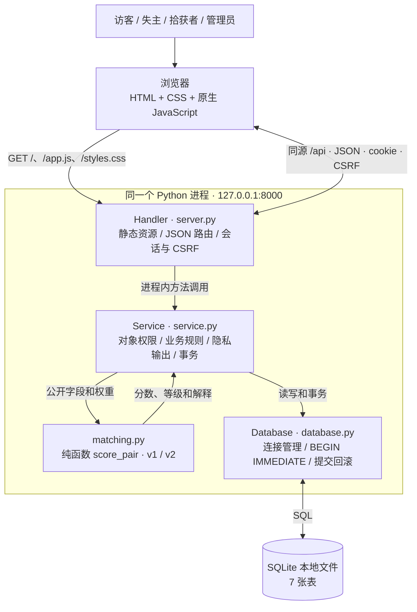
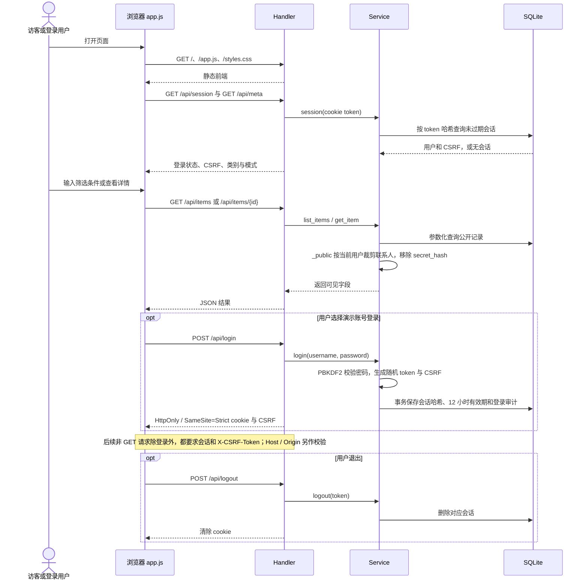
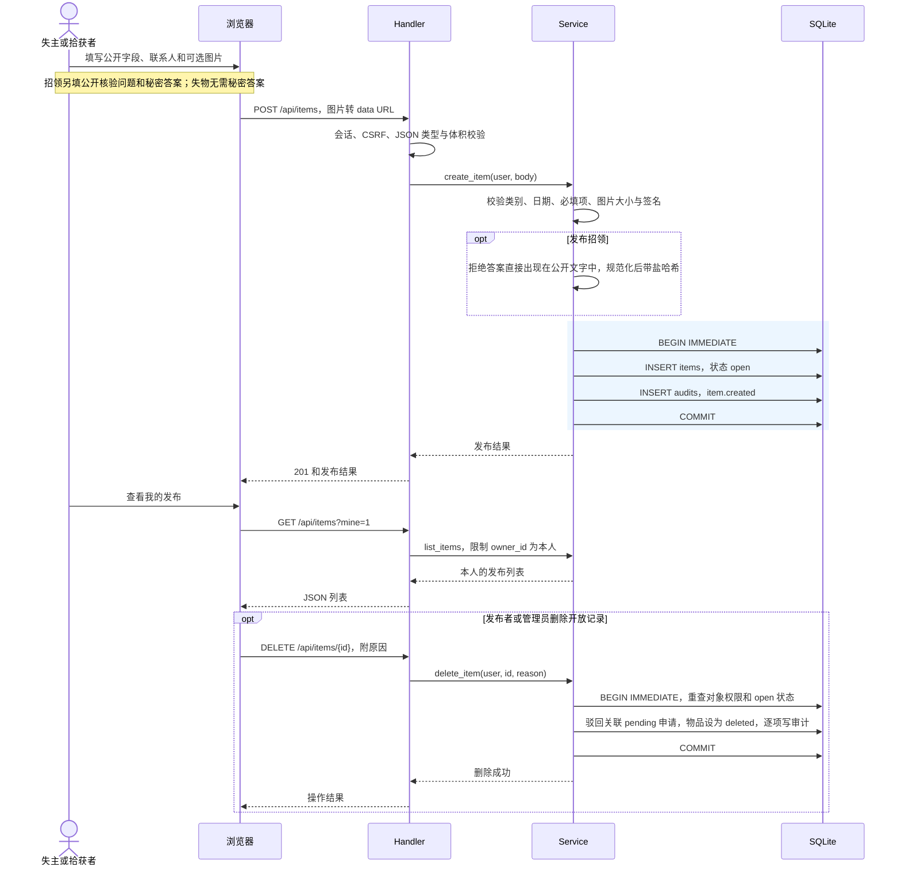
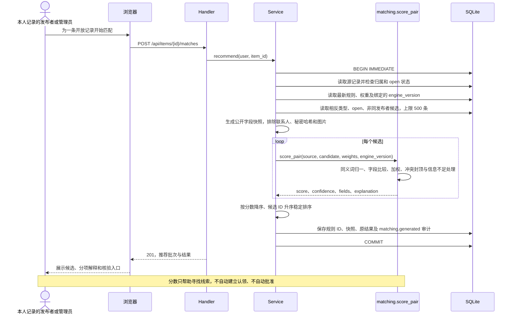
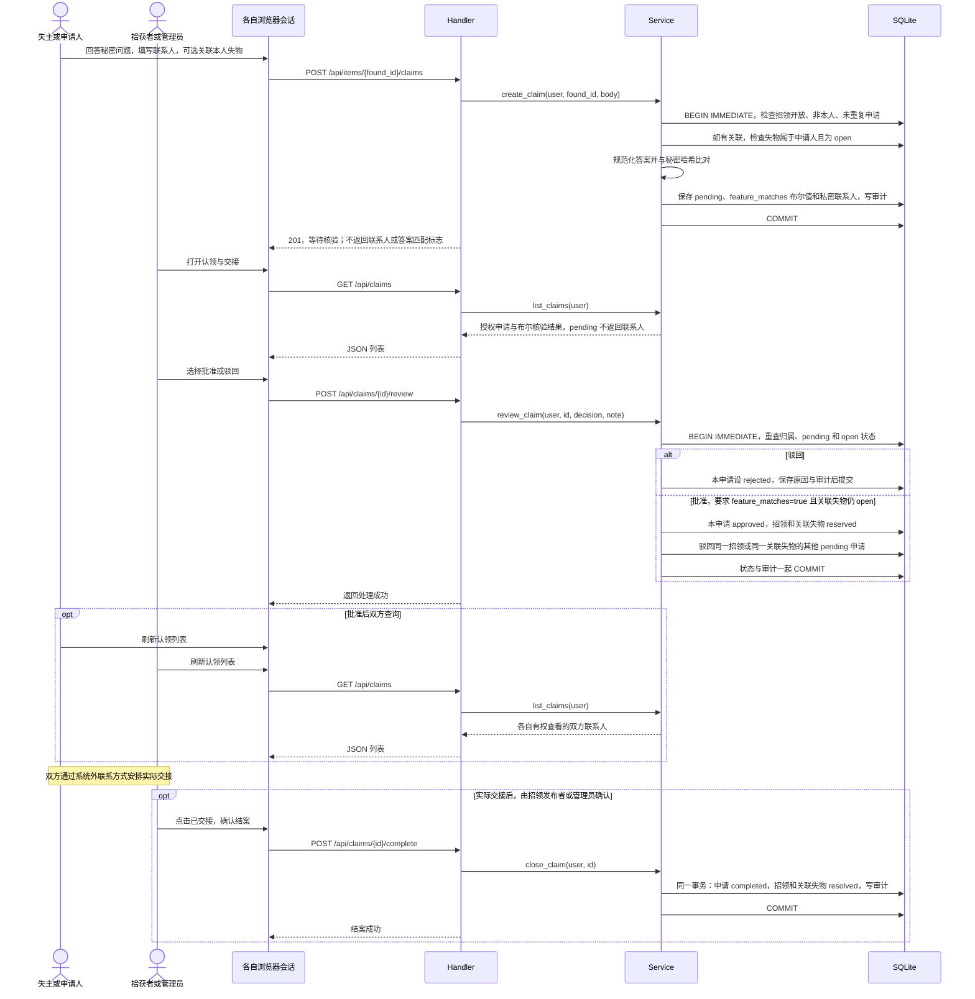
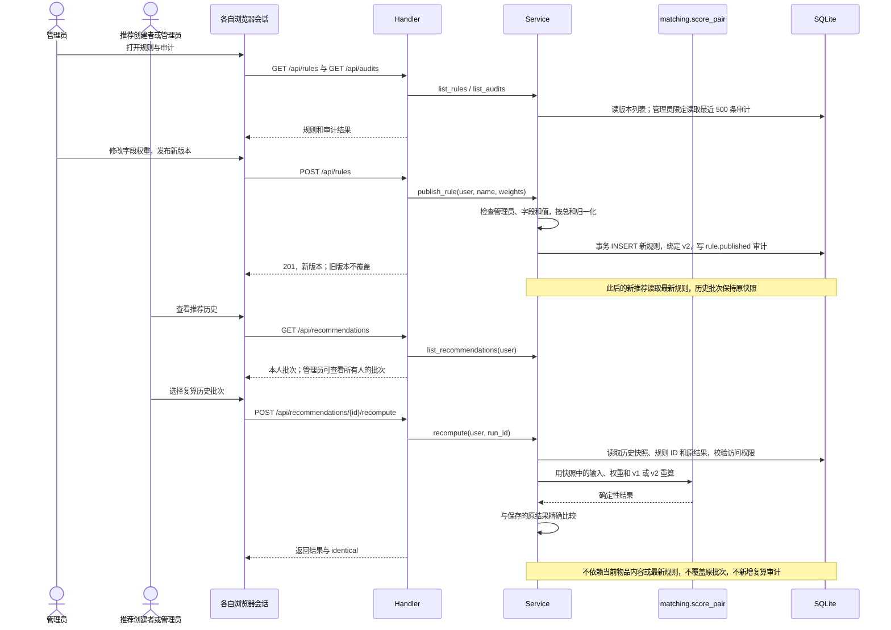
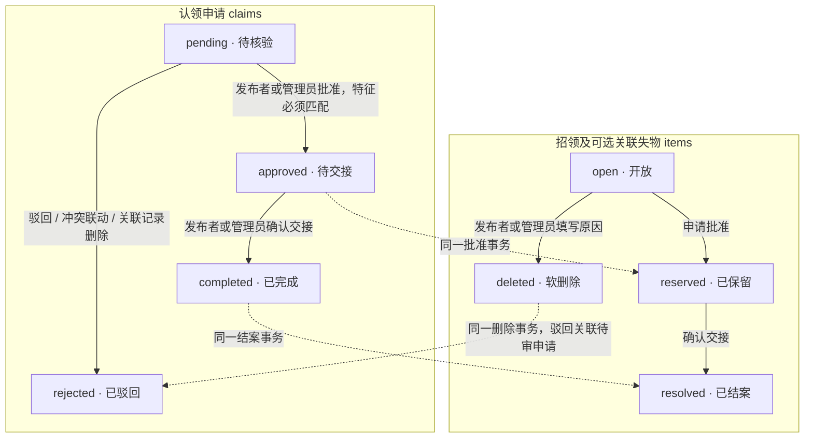

# 面试速读：架构、用户旅程与技术取舍

依据：当前 `src/server.py`、`src/service.py`、`src/database.py`、`src/matching.py` 和 `src/static/app.js`，核对日期 2026-10-27。本文用于解释已实现系统，不把演进建议当作现有能力。

建议先读图 1、4、5、6，抓住架构、推荐、认领、追溯四条主线；图 2、3、7 用于补充权限、发布和状态问题。图中的多用户前端表示各自当前的浏览器会话；演示时也可以在同一浏览器切换账号。

## 先记住这段介绍

这是一个校园失物招领系统，用 Python 标准库和 SQLite 实现本地可运行的分层单体。Python 同时提供静态前端和 JSON API，浏览器执行原生 JavaScript。产品闭环是发布与搜索、候选匹配、私密特征核验、人工批准、联系交接和结案。匹配用确定性的离线文本算法，分数只帮助寻找候选。联系方式由后端按权限裁剪，关键状态与审计在同一事务内提交；推荐保存公开输入、权重和算法版本，因此规则变化后仍能复算历史。

这里的“AI”是题目允许的离线匹配模拟器，不是接入了大语言模型。开发过程使用 AI 助手，与应用中的匹配算法是两件事。

## 用户是谁，可以做什么

数据库只有 `user`、`admin` 两种角色；“失主”和“拾获者”是业务身份，由记录类型和发布者决定。同一普通账号可以同时发布失物和招领。

| 用户身份 | 主要旅程 | 权限边界 |
| --- | --- | --- |
| 访客 | 浏览、组合筛选、查看详情与核验问题 | 不能发布、匹配或认领；没有他人联系方式和秘密哈希 |
| 失主/申请人 | 发布失物 → 匹配或搜索 → 申请认领 → 等待核验 → 联系交接 | 只能关联本人开放的失物；只能看自己参与的申请；不能批准或确认交接 |
| 拾获者/招领发布者 | 发布招领与秘密问题 → 查看申请 → 批准/驳回 → 交接结案 | 只能管理本人发布的记录及其申请；核验前看不到申请人的私密联系人 |
| 管理员 | 管理记录与核验、发布权重版本、查看审计、复算推荐 | 可以跨发布者管理；管理员是联系方式访问的管理例外，不能说所有人都必须等批准才能查看 |

账号演示：`alice`、`bob` 是普通用户，`admin` 是管理员。预置账号不是校园真实身份认证。规则列表 API 可公开读取，前端“规则与审计”页面只对管理员展示；规则发布和审计 API 均由后端限制为管理员。

## 图 1：部署和模块调用关系

**讲解要点：** HTTP 是浏览器与后端之间的边界；`Handler → Service → Database / matching` 是进程内调用，不是微服务 RPC。`app.py` 是启动入口。没有另一个前端服务器、消息队列、远程模型或独立图片服务。

数据库按职责保存：`users` / `sessions` 管身份，`items` / `claims` 管业务，`rules` / `recommendations` 管规则与追溯，`audits` 管操作记录。图片作为受限 data URL 随物品保存在 SQLite，只展示，不参与匹配。

## 图 2：访客浏览、登录与恢复会话

**讲解要点：** 不只隐藏前端按钮，后端还会鉴权、检查对象归属并裁剪返回字段。cookie 是随机会话令牌，不是 JWT；数据库保存令牌的 SHA-256 哈希，前端不需要读取 HttpOnly cookie。CSRF 用于约束浏览器携带会话的修改请求，不能代替对象权限校验。

联系人规则：发布者可看自己记录，管理员可管理访问；认领批准/完成后，对应双方可获取联系信息。秘密哈希不会作为公开物品字段返回。普通用户不能读取管理员审计 API。

## 图 3：失主/拾获者发布，发布者/管理员删除

**讲解要点：** 删除是状态变更，不物理删除。只能删除 `open` 记录，`reserved` 必须先交接。系统没有发布后编辑接口，也没有取消申请接口。图片最多 500,000 字节，仅检查类型和文件签名，尚无完整解码或图片泄密检测。

发布后联系人对发布者自己可见，不意味着广场访客也能看到。程序无法识别用户把秘密答案放进图片或用其他文字间接泄露，仍需要人工注意。

## 图 4：失主找招领，拾获者找失物——共用推荐服务

**讲解要点：** 失物→招领、招领→失物共用同一个 `recommend`，差别只是源记录 `kind`。当前没有向量检索、外部模型请求、固定最低分过滤或 Top 10 截断；读取的最多 500 个候选均评分并排序。

算法速记：

- 五项默认权重：类别 25%、地点 20%、颜色 15%、时间 15%、描述 25%。
- 类别/颜色比较规范化后是否相等；地点/描述比较归一后的文本，完全相同为 1，包含关系为 0.85，其余使用字符二元组 Dice。
- 时间比较日期区间：重叠得 1，否则按间隔天数在 14 天内衰减到 0。
- 缺失字段记 0，不因为字段缺失而重新缩小分母。类别冲突最高 30 分，颜色冲突或时间完全不相容最高 49 分。
- 启用且双方有效可比的字段少于 3 项时标记 `insufficient`，分数最高 35；其余按 75/50 阈值分高/中/低。这些等级不是经过统计校准的归属概率。
- 解释由实际字段结果拼接，不是再请求模型生成。图片和秘密答案均不进入评分。

当前推荐计算也在写事务中，保证读取、快照和保存是一致的，但会占用 SQLite 写锁；这对本地小规模验收简单，对大规模匹配是明确的扩展瓶颈。

## 图 5：失主申请 → 拾获者核验 → 联系交接 → 结案

**讲解要点：** 答案不正确仍能创建待核验申请，但后端禁止批准；正确答案也不会自动批准，仍要人工操作。提交答案只在请求处理时使用，数据库不保存答案原文；招领保存预设答案哈希，申请保存是否匹配的布尔值。

没有关联失物也能认领，但要提供私密联系人；关联失物时后端可从该失物补足联系人，当前前端表单始终要求填写联系人。申请人不能核验或结案；发布者或管理员负责确认交接。冲突申请在**批准时**驳回，不等到结案，更不能按申请人身份驳回他在其他物品上的全部申请。

并发批准靠后端写事务内重查和数据库唯一索引保证，前端禁用按钮只改善交互。

## 图 6：管理员调规则、用户复算历史、管理员查审计

**讲解要点：** “重新匹配”和“复算历史”是两种不同操作。前者使用当前开放候选和最新规则，创建新批次；后者验证当时的计算，读取冻结快照，不写回。接口虽为 POST，`recompute` 内部使用只读数据库连接；HTTP 层仍要求会话和 CSRF。

规则是新增即发布，没有草稿、覆盖修改或撤销接口。权重不要求手工加总为 100，服务会归一化；0 代表禁用。只启用一两项虽然允许发布，但后续匹配会因有效字段少于 3 项标记信息不足。

真实的版本取舍案例：修复“一食堂”重复归一化后，同一旧输入可能从 97 分变成 100 分。如果只修代码而不升级算法版本，历史结果就失去可复现性。因此保留 v1 原行为，新规则使用 v2；遇到不支持的历史算法版本会拒绝复算，不悄悄套用最新算法。

## 图 7：状态联动与并发保护

**讲解要点：** `BEGIN IMMEDIATE` 先取得写事务，再重查状态，两个并发核验不能都基于过期状态通过。`one_winner` 部分唯一索引限制同一招领最多一条 `approved/completed` 申请；同一关联失物的冲突依靠事务内重查、保留状态及联动驳回处理。业务状态与对应审计一起提交，失败一起回滚。

一个申请批准可同时改变“申请、招领、关联失物、其他冲突申请、审计”，这些是同一数据库的原子操作，没有引入分布式事务。系统没有取消、撤销核验或重新打开结案流程，不能在图里补造反向状态边。

## 技术取舍：每项都要能说出收益和代价

| 选择 | 为什么适合当前题目 | 付出的代价 / 扩展方向 |
| --- | --- | --- |
| Python 标准库 HTTP + 原生前端，同源部署 | 无需第三方运行包、前端构建和第二个服务，评审本地容易启动；职责仍分层 | 路由、校验、页面状态需要自己维护；规模扩大可迁成熟 Web 框架，复杂前端再引入组件框架 |
| 分层单体 + SQLite | 用户、认领、物品、规则、审计能用本地事务直接保证一致性，便于复现 | SQLite 同时只有一个写者；没有实际压测容量承诺，扩展可选服务型数据库 |
| 服务端 cookie 会话 + CSRF | 同源应用无需把身份令牌交给 JavaScript；可在服务端删除会话 | 要维护会话表；当前是本地 HTTP，生产还需 HTTPS、Secure cookie、正式身份与登录防护 |
| 确定性文本匹配，v1/v2 保留 | 无密钥和网络依赖，结果可解释、可复算，演示不会受模型波动影响 | 同义词和字符相似度理解有限，没有图像语义；12 组样例不是现实准确率；新增模型须保留版本和回退策略 |
| 秘密哈希 + 人工批准 + 后端字段裁剪 | 不保存申请答案原文，避免高相似候选直接暴露联系人或确定归属 | 只能规范化精确比对，不能接受自由同义答案；没有真实物权证明，也没有答案尝试限流 |
| 冻结公开输入、权重、算法版本和结果 | 规则变化、源记录结案或软删除后，仍能复现推荐依据 | 快照增加存储；公开文本也可能含用户主动填写的信息，生产需保留期限和隐私删除策略 |
| 写事务 + 部分唯一索引 + 审计 | 并发下防双重批准；业务变更与审计同成同败 | 写入串行；当前推荐计算和部分哈希比对也占用写事务，扩大数据量时应缩短临界区并明确一致性方案 |
| 图片 data URL 存 SQLite | 无额外文件路径、对象存储或部署依赖，源码演示简单 | base64 和列表返回增加体积，文件校验有限；规模扩大应拆到对象存储并增加解码校验 |

回答技术选型时，把约束说具体：以题目要求的本地可复现、隐私、闭环和可追溯为优先，接受当前规模下的简单实现，再讲明扩展瓶颈。

## 常见 callback 追问

**前端在哪里，为什么不用 Node.js 也有页面？** `src/static/` 的 HTML、CSS、JS 是实际前端。Python 返回文件，浏览器执行 JS；Node.js 只用于可选开发检查和 Playwright 回归。

**为什么匹配 100 分还不能自动认领？** 相似度反映公开描述一致，不等于物权证明。系统仍要求私密特征匹配，并由发布者/管理员批准。

**两个拾获者同时批准同一个失主关联的失物呢？** 写事务串行，首个批准将关联失物设为 `reserved`，并驳回同一失物的其他待审申请；后一个事务重查状态时不能再通过。

**单靠唯一索引够不够？** 不够。索引按招领 `item_id` 防同一招领双重批准，关联失物的互斥、状态和审计还依赖事务内的业务检查。

**只存 rule_id 为什么不够？** 原记录、候选集和算法代码都可能变化。必须同时冻结输入、权重和算法版本，并保留对应算法实现，才能复现。

**删了记录为什么还能复算？** 删除是软删除，且复算直接读取批次快照，不再从物品的当前状态构建输入；原详情接口对已删除记录仍返回 404。

**有什么证据，哪些还没测？** 2026-10-27 留存的结果是 22 项 unittest、12 组构造 AI 评测及浏览器主流程通过，详见[测试报告](06-test-report.md)。本文只是核对代码与图，没有重跑程序测试；未做生产压测、真实校园身份验证和大规模语义评测。

**如果明天要上线，先改什么？** 先确认真实身份、HTTPS/会话安全、登录与答案尝试限流、隐私与图片处理，再按实际用户量改数据库、检索分页和文件存储。不要承诺直接把本地演示暴露公网就具备生产能力。

## 追问时去哪里找代码

| 功能 | HTTP 接口 | 主要实现 |
| --- | --- | --- |
| 健康与元信息 | `GET /api/health`、`GET /api/meta` | `Handler._route` |
| 会话、登录、退出 | `GET /api/session`、`POST /api/login`、`POST /api/logout` | `Service.session/login/logout` |
| 物品列表与详情 | `GET /api/items`、`GET /api/items/{id}` | `Service.list_items/get_item/_public` |
| 发布、删除 | `POST /api/items`、`DELETE /api/items/{id}` | `Service.create_item/delete_item` |
| 创建推荐 | `POST /api/items/{id}/matches` | `Service.recommend/_snapshot/_calculate`、`matching.score_pair` |
| 提交与查询认领 | `POST /api/items/{id}/claims`、`GET /api/claims` | `Service.create_claim/list_claims` |
| 核验与交接 | `POST /api/claims/{id}/review`、`POST /api/claims/{id}/complete` | `Service.review_claim/close_claim` |
| 规则查询与发布 | `GET /api/rules`、`POST /api/rules` | `Service.list_rules/publish_rule` |
| 推荐历史与复算 | `GET /api/recommendations`、`POST /api/recommendations/{id}/recompute` | `Service.list_recommendations/recompute` |
| 管理员审计 | `GET /api/audits` | `Service.list_audits/_audit` |

源码入口：[server.py](../src/server.py)、[service.py](../src/service.py)、[database.py](../src/database.py)、[matching.py](../src/matching.py)、[前端 app.js](../src/static/app.js)。更完整的字段定义见[架构文档](03-architecture.md)，边界和验收见[规格](01-spec.md)。
